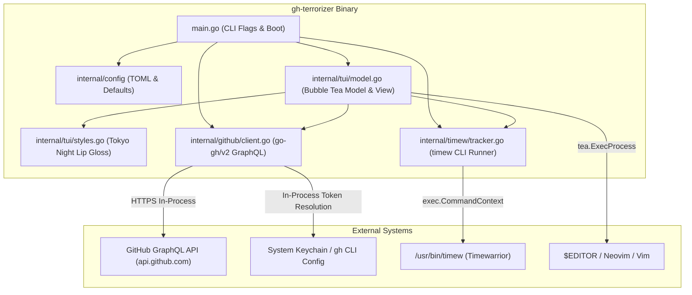

# gh-terrorizer: Terminal Kanban & Time Tracking Workstation

*   **Author:** ejablonski
*   **Status:** Approved
*   **Date:** 2026-10-30

--------------------------------------------------------------------------------

## Overview

`gh-terrorizer` is a terminal-based developer workstation for managing GitHub Projects v2 Kanban boards and tracking task execution time via Timewarrior (`timew`). Built with Go and Charmbracelet Bubble Tea, it interacts with GitHub's GraphQL API in-process via `github.com/cli/go-gh/v2`, automatically resolving authentication, credentials, and host settings from the user's existing GitHub CLI (`gh`) environment. Developers can inspect board columns, move cards across workflow states with Vim keybindings, and start or stop local Timewarrior sessions that automatically accumulate tracked intervals into a designated GitHub Projects v2 float custom field (representing hours spent).

--------------------------------------------------------------------------------

## The Problem

Software engineers working in terminal environments face significant friction when managing task lifecycles:
1. **Context Fragmentation**: Triaging GitHub Projects v2 Kanban boards requires switching away from terminal workflows to a web browser, disrupting focus during active development.
2. **Disconnected Time Tracking**: Local CLI time tracking tools like Timewarrior operate in isolation from project management infrastructure. Logging time locally does not synchronize with project management fields on GitHub, resulting in manual data entry or untracked task hours.
3. **Authentication Friction**: Custom API tools often demand dedicated Personal Access Tokens (PATs) or bespoke OAuth configurations rather than leveraging existing developer credentials already stored by the official GitHub CLI (`gh`).
4. **Subprocess Overhead in TUI Applications**: Naive terminal tools that shell out to CLI binaries (`exec.Command("gh", ...)`) introduce $150 - 450\text{ ms}$ latency per operation, degrading TUI frame rates and risking process zombie leaks.

`gh-terrorizer` solves these issues by providing a keyboard-driven TUI that couples in-process GitHub GraphQL execution via `go-gh/v2` with local Timewarrior subprocess invocations, updating custom float fields directly on GitHub Project items without web context switches.

--------------------------------------------------------------------------------

## Goals

*   Provide an interactive terminal Kanban board for GitHub Projects v2 with column transitions driven by Vim motions (`h`, `j`, `k`, `l`, `H`, `L`).
*   Communicate with GitHub in-process using `github.com/cli/go-gh/v2`, reusing existing `gh` CLI credentials, host configurations, and keychain tokens with zero credential setup.
*   Integrate Timewarrior (`timew`) tracking into project cards, starting and stopping local tracking intervals via the `t` key.
*   Automatically calculate elapsed tracking intervals $\Delta t$ and increment a designated GitHub Projects v2 float custom field representing hours spent (e.g., $0.50$ for $30\text{ minutes}$).
*   Render board state directly on boot with a non-blocking Charm `spinner`, fetching fresh remote data without complex local disk cache synchronization.
*   Support issue description editing by suspending Bubble Tea via `tea.ExecProcess` to hand control directly to the user's native `$EDITOR` or `gh issue edit`.
*   Handle both User-owned and Organization-owned GitHub Projects v2 boards seamlessly.
*   Safely display polymorphic card contents (Issues, Pull Requests, Draft Issues) and read-only milestone badges.
*   Enforce OAuth scope checks on startup: if `project` scope is missing, display actionable remediation guidance (`gh auth refresh -s project`) and terminate cleanly.
*   Deliver customizable styling with the Tokyo Night palette as the default theme, accompanied by Nerd Font iconography.

--------------------------------------------------------------------------------

## Non-Goals

*   Pull Request (PR) lifecycle management, review commenting, or inline diff viewing (PRs are displayed on the board as read-only cards).
*   Milestone administrative workflows (creating, deleting, or rescheduling milestones; milestones are supported strictly as read-only badges on cards).
*   Alternative GitHub Projects v2 layouts (Table view, Roadmap/Timeline view, or custom analytical charts).
*   Vertical card reordering within columns (card movement is strictly horizontal across status columns via `updateProjectV2ItemFieldValue`).
*   Offline two-way synchronization engine or local disk caching (upstream GitHub is the authoritative source of truth, queried directly on boot and refreshed on demand).
*   Continuous background CLI drift polling (Timewarrior operations are strictly initiated by user keyboard triggers).
*   Custom in-TUI markdown editor components (multiline editing delegates to native `$EDITOR`).

--------------------------------------------------------------------------------

## Open Questions

*   **Question 1**: When a project item is a draft issue without an underlying repository issue, how should Timewarrior tags be structured?
    *   *Resolution*: Use the project item ID and title slug: `timew start "proj-<itemID> <title>" :gh`.

--------------------------------------------------------------------------------

## Critical User Journeys (CUJs)

### CUJ 1: Moving a Card Across Kanban Columns

*   **Given**: The user has `gh-terrorizer` open displaying a Projects v2 board with columns "Todo", "In Progress", and "Done". The cursor is focused on an issue card in "Todo".
*   **When**: The user presses `L` (or enters move mode with `m` followed by `l`).
*   **Then**: The card immediately shifts to the "In Progress" column in local UI state (optimistic update). In the background, an asynchronous `tea.Cmd` executes `updateProjectV2ItemFieldValue` via `go-gh/v2`. If the call succeeds, local state remains updated. If the call fails, the card reverts to "Todo" on the next render frame and an error message flashes in the status bar.

### CUJ 2: Tracking Time and Updating Custom Float Hours

*   **Given**: Issue `#42` is selected on the board. The project's configured custom float field "Hours Spent" currently holds value $1.50$.
*   **When**: The user presses `t` on Issue `#42`.
*   **Then**: `gh-terrorizer` executes `timew start "gh-42 Fix auth bug" :gh` via subprocess. An orange timer badge (`󱎫`) pulses on card `#42`. When the user completes work and presses `t` again (or presses `t` on another card), the application executes `timew stop`, calculates elapsed duration $\Delta h = \frac{\Delta s}{3600}$, rounds to precision $p = 2$, performs an in-process GraphQL mutation to set the field to $1.50 + \Delta h_{\text{rounded}}$, and updates the card UI.

### CUJ 3: Editing an Issue Body via External `$EDITOR`

*   **Given**: The user is inspecting an issue card on the board.
*   **When**: The user presses `e`.
*   **Then**: Bubble Tea suspends terminal alternate screen mode via `tea.ExecProcess`, opening the user's configured `$EDITOR` (or invoking `gh issue edit <number>`). Once the user saves and exits the editor, Bubble Tea restores the TUI layout and refreshes the card content from GitHub.

### CUJ 4: Startup Pre-Flight Health Check

*   **Given**: The user launches `gh-terrorizer` in a terminal where `gh` is authenticated, but lacks the `project` OAuth scope.
*   **When**: Application boot executes pre-flight scope validation.
*   **Then**: The application terminates cleanly with an exit code of $1$ and prints actionable instructions to stderr: `Error: GitHub CLI lacks 'project' scope. Run 'gh auth refresh -s project' to grant permissions.`

--------------------------------------------------------------------------------

## Architecture & System Design

### 1. Minimalist System Architecture

`gh-terrorizer` adheres to a streamlined, idiomatic Go architecture comprising 6 core files across 4 packages. In-process GraphQL execution eliminates subprocess spawning for remote operations, while Timewarrior tracking is isolated in a dedicated tracker client.



### 2. File Organization & Package Responsibilities

```text
gh-terrorizer/
├── go.mod                      # bubbletea, lipgloss, bubbles, go-gh/v2, go-toml/v2
├── main.go                     # Stdlib flag parsing, pre-flight check, Bubble Tea runner
├── internal/
│   ├── config/
│   │   └── config.go           # TOML configuration parser with sensible defaults
│   ├── github/
│   │   └── client.go           # In-process GraphQL client via go-gh/v2 (queries & mutations)
│   ├── timew/
│   │   └── tracker.go          # Subprocess runner for timew start/stop & JSON interval parsing
│   └── tui/
│       ├── model.go            # Root Bubble Tea model: Kanban board, column viewports, keybindings
│       └── styles.go           # Tokyo Night Lip Gloss styling definitions
```

### 3. GitHub Projects v2 In-Process GraphQL Protocol

All remote queries and mutations execute in-process via `api.DefaultGraphQLClient()` from `github.com/cli/go-gh/v2/pkg/api`.

#### Dynamic Board & Card Query with Pagination
```graphql
query FetchProjectBoard($owner: String!, $projectNumber: Int!, $cursor: String) {
  repositoryOwner(login: $owner) {
    ... on User {
      projectV2(number: $projectNumber) {
        ...ProjectFields
      }
    }
    ... on Organization {
      projectV2(number: $projectNumber) {
        ...ProjectFields
      }
    }
  }
}

fragment ProjectFields on ProjectV2 {
  id
  title
  fields(first: 20) {
    nodes {
      ... on ProjectV2SingleSelectField {
        id
        name
        options { id name color }
      }
      ... on ProjectV2Field {
        id
        name
        dataType
      }
    }
  }
  items(first: 100, after: $cursor) {
    pageInfo {
      hasNextPage
      endCursor
    }
    nodes {
      id
      type
      fieldValues(first: 10) {
        nodes {
          ... on ProjectV2ItemFieldSingleSelectValue {
            name
            field { ... on ProjectV2SingleSelectField { name } }
          }
          ... on ProjectV2ItemFieldNumberValue {
            number
            field { ... on ProjectV2Field { name } }
          }
        }
      }
      content {
        ... on Issue {
          id
          number
          title
          body
          state
          milestone { title dueOn }
          labels(first: 10) { nodes { name color } }
          assignees(first: 5) { nodes { login } }
        }
        ... on PullRequest {
          id
          number
          title
          state
          labels(first: 5) { nodes { name color } }
        }
        ... on DraftIssue {
          id
          title
          body
        }
      }
    }
  }
}
```

#### Status Transition Mutation
```graphql
mutation MoveCardStatus($projectId: ID!, $itemId: ID!, $fieldId: ID!, $optionId: String!) {
  updateProjectV2ItemFieldValue(
    input: {
      projectId: $projectId
      itemId: $itemId
      fieldId: $fieldId
      value: { singleSelectOptionId: $optionId }
    }
  ) {
    projectV2Item { id }
  }
}
```

#### Custom Float Field Update Mutation
```graphql
mutation UpdateHoursSpent($projectId: ID!, $itemId: ID!, $fieldId: ID!, $totalHours: Float!) {
  updateProjectV2ItemFieldValue(
    input: {
      projectId: $projectId
      itemId: $itemId
      fieldId: $fieldId
      value: { number: $totalHours }
    }
  ) {
    projectV2Item { id }
  }
}
```

### 4. Timewarrior Tracking Protocol & Interval Arithmetic

When tracking is started on an item via keyboard trigger `t`:
1. If a prior session is active, `gh-terrorizer` calls `timew stop` and captures the stopped interval.
2. The application executes `timew start "<tag>" :gh`.
3. The elapsed seconds $\Delta s$ from the stopped session are converted into decimal hours:
   $$\Delta s = t_{\text{stop}} - t_{\text{start}}$$
   $$\Delta h = \frac{\Delta s}{3600}$$
4. Rounding is applied using Go's standard library `math.Round` to precision $p$ decimal places (default $p = 2$):
   $$\Delta h_{\text{rounded}} = \frac{\text{round}(\Delta h \cdot 10^p)}{10^p}$$
5. The updated total hours $T_{\text{new}}$ is calculated additively against the current remote value $T_{\text{prev}}$:
   $$T_{\text{new}} = \text{coalesce}(T_{\text{prev}}, 0.0) + \Delta h_{\text{rounded}}$$
   where $\text{coalesce}(a, b) = a$ if $a \ne \text{nil}$, else $b$.
6. `UpdateHoursSpent` is dispatched in an asynchronous `tea.Cmd`.

### 5. Viewport Adaptation Algorithm

Let $W$ be total terminal window width, and let $K$ be the number of Kanban columns on the board.
1. If $K \le 0$:
   Render a clean empty-state message: `No status columns found on project board.`
2. If $K > 0$:
   Compute the number of visible columns fitting side-by-side ($W_{\min} = 25$):
   $$K_{\text{vis}} = \min\left(K, \max\left(1, \left\lfloor \frac{W}{W_{\min}} \right\rfloor\right)\right)$$
   If $K_{\text{vis}} > 1$ or $K = 1$:
   * Render $K_{\text{vis}}$ columns side-by-side using Lip Gloss horizontal joins.
   * Individual column outer widths are distributed across $W$ cleanly without overflow:
     $$w_{\text{base}} = \left\lfloor \frac{W}{K_{\text{vis}}} \right\rfloor, \quad R = W \pmod{K_{\text{vis}}}$$
   * Viewport slides horizontally to keep $C_{\text{active}}$ in view ($V_{\text{start}} \le C_{\text{active}} < V_{\text{start}} + K_{\text{vis}}$), showing `◀` and `▶` indicators when columns exist beyond the screen edges.
3. Otherwise ($W < 50$ and $K > 1$):
   Degrade to **Single-Column Tabbed Mode**:
   * Render a header showing column tabs (`[1: Todo]` `[2: In Progress]` `[3: Done]`).
   * Render the active column $C_{\text{active}}$ across the full terminal width: $w_{\text{active}} = W - 2$.
   * Navigation between columns switches to numeric keys `1`–`9` or `Tab` / `Shift+Tab`.

--------------------------------------------------------------------------------

## Alternatives Considered

### Alternative 1: Shelling Out to `gh` CLI Binary via Subprocesses

*   **Pros**: Leverages CLI binary directly without Go library dependencies.
*   **Cons**: Introduces $150 - 450\text{ ms}$ latency per mutation, brittle stdout string parsing, risk of process leaks, and requires mock runner layers for unit testing.
*   **Reason for Rejection**: `github.com/cli/go-gh/v2` provides official, pre-authenticated in-process GraphQL execution with HTTP keep-alive pools and native struct unmarshaling, eliminating subprocess latency completely.

### Alternative 2: Local Disk Caching Subsystem

*   **Pros**: Sub-millisecond initial render on cold boot.
*   **Cons**: Introduces stale-read write overwrite risks on custom float fields, visual card jumping on sync, and atomic temporary file swapping overhead.
*   **Reason for Rejection**: An in-process GraphQL query completes in $\approx 200 - 350\text{ ms}$. Displaying a Charm `spinner` on boot provides clean visual feedback and avoids distributed state synchronization bugs.

### Alternative 3: Embedded Multiline Textarea Modal (`bubbles/textarea`)

*   **Pros**: Avoids terminal screen clearing.
*   **Cons**: Lacks advanced text editing features (Vim modes, syntax highlighting, undo tree), introduces modal state machine deadlocks, and bloats UI logic.
*   **Reason for Rejection**: Bubble Tea's `tea.ExecProcess` suspends the TUI and opens the user's native `$EDITOR` or `gh issue edit` cleanly, matching proven CLI workflows like Git and Lazygit.

### Alternative 4: Background Timewarrior State Drift Polling

*   **Pros**: Automatically detects tracking sessions started in external terminal tabs.
*   **Cons**: `dom.active` is a boolean scalar (`1` vs `0`), requiring multi-step CLI queries that waste CPU cycles and introduce race conditions.
*   **Reason for Rejection**: User-triggered time tracking (`t`) is deterministic, lightweight, and eliminates background polling overhead.

--------------------------------------------------------------------------------

## Non-Functional Requirements

### 1. Security & Authentication
*   **Zero Credential Persistence**: `gh-terrorizer` never persists GitHub tokens to disk or logs. All authentication is resolved in-memory from the host `gh` CLI environment via `go-gh/v2`.
*   **Scope Enforcement**: The application verifies the presence of the `project` OAuth scope on startup, terminating with an explicit warning if missing.

### 2. Performance & UI Responsiveness
*   **Mutation Latency**: In-process GraphQL mutations must complete within $100\text{ ms}$ on broadband connections.
*   **Input Response**: Vim motion navigation (`h`, `j`, `k`, `l`) must process within $16\text{ ms}$ ($60\text{ FPS}$).
*   **Synchronous UI Updates**: Card movements update local UI state immediately (optimistic UI), rolling back on the next render cycle ($< 1\text{ ms}$) if the mutation fails.

--------------------------------------------------------------------------------

## Detailed Implementation Plan

### Target Files to Create/Modify

#### 1. `go.mod` (Create)
*   **Type / Scope**: Build Configuration & Dependencies
*   **Proposed Changes**: Initialize module `github.com/ejablonski/gh-terrorizer` using Go 1.22+. Declare minimal dependencies:
    *   `github.com/charmbracelet/bubbletea` (Elm TUI runtime)
    *   `github.com/charmbracelet/lipgloss` (Styling & layout)
    *   `github.com/charmbracelet/bubbles` (`spinner`, `viewport`, `key`, `help`)
    *   `github.com/cli/go-gh/v2` (Official in-process GitHub CLI SDK)
    *   `github.com/pelletier/go-toml/v2` (TOML configuration parsing)

#### 2. `main.go` (Create)
*   **Type / Scope**: Application Entrypoint & CLI Flags
*   **Proposed Changes**: Use standard library `flag` to parse `--owner`, `--repo`, and `--project`. Load configuration from `~/.config/gh-terrorizer/config.toml` (or path in `$GH_TERRORIZER_CONFIG`). Run startup pre-flight checks:
    *   Check for `timew` in `$PATH` (`exec.LookPath("timew")`). If missing, log warning and set `Config.Timewarrior.Enabled = false`.
    *   Verify `project` OAuth scope via `go-gh/v2` auth helper. If missing, exit with status $1$ and remediation instructions (`gh auth refresh -s project`).
    Initialize Bubble Tea program with `tea.WithAltScreen()` and run root model.

#### 3. `internal/config/config.go` (Create)
*   **Type / Scope**: Configuration Subsystem
*   **Proposed Changes**: Define `Config` struct:
    ```go
    type Config struct {
        DefaultOwner    string           `toml:"default_owner"`
        DefaultRepo     string           `toml:"default_repo"`
        ProjectNumber   int              `toml:"project_number"`
        Timewarrior     TimewarriorConfig `toml:"timewarrior"`
        Theme           ThemeConfig      `toml:"theme"`
    }
    type TimewarriorConfig struct {
        Enabled          bool   `toml:"enabled"`
        HoursCustomField string `toml:"hours_custom_field"` // Default: "Hours Spent"
        RoundingPrecision int    `toml:"rounding_precision"`  // Default: 2
        TagPrefix        string `toml:"tag_prefix"`         // Default: "gh-"
    }
    type ThemeConfig struct {
        TokyoNightVariant string `toml:"variant"`    // Default: "storm"
        ShowIcons         bool   `toml:"show_icons"` // Default: true
    }
    ```
    Implement `LoadConfig(path string) (*Config, error)` returning concrete defaults when the file is absent.

#### 4. `internal/github/client.go` (Create)
*   **Type / Scope**: GitHub GraphQL Client Adapter
*   **Proposed Changes**: Wrap `go-gh/v2/pkg/api.GraphQLClient`. Define domain structs:
    ```go
    type ProjectBoard struct {
        ID            string
        Title         string
        StatusFieldID string
        HoursFieldID  string
        Columns       []Column
        Items         []ProjectItem
    }
    type Column struct {
        ID    string
        Name  string
        Color string
    }
    type ProjectItem struct {
        ID             string
        Type           string
        StatusOptionID string
        HoursSpent     float64
        Title          string
        Body           string
        Number         int
        State          string
        Labels         []Label
        Milestone      *Milestone
    }
    type Label struct {
        Name  string
        Color string
    }
    type Milestone struct {
        Title string
        DueOn string
    }
    ```
    Implement methods:
    *   `FetchBoard(ctx context.Context, owner string, number int) (*ProjectBoard, error)` (with cursor pagination and dynamic `repositoryOwner` resolution).
    *   `MoveCard(ctx context.Context, projectID, itemID, fieldID, optionID string) error`.
    *   `UpdateHours(ctx context.Context, projectID, itemID, fieldID string, totalHours float64) error`.

#### 5. `internal/timew/tracker.go` (Create)
*   **Type / Scope**: Timewarrior Subprocess Adapter
*   **Proposed Changes**: Provide `Tracker` struct executing `timew` commands:
    *   `Start(tag string, annotations ...string) error`: Executes `exec.CommandContext("timew", "start", tag, ...)`.
    *   `Stop() (elapsedSeconds int, err error)`: Executes `exec.CommandContext("timew", "stop")`, parses interval start/end from `timew export` JSON (or output), and calculates elapsed seconds $\Delta s$.
    *   `CalculateHours(elapsedSeconds int, precision int) float64`: Converts $\Delta s$ to decimal hours rounded via `math.Round`.

#### 6. `internal/tui/model.go` (Create)
*   **Type / Scope**: Bubble Tea Model & View
*   **Proposed Changes**: Implement `tea.Model`:
    *   `Init()`: Returns command to fetch board data via `client.FetchBoard` with a Charm `spinner`.
    *   `Update(msg tea.Msg)`:
        *   Handle `tea.KeyMsg`: Vim motions (`h`/`l` column switch, `j`/`k` vertical card selection, `g`/`G` top/bottom).
        *   Card Move (`H`/`L` or `m`): Optimistically update card column; dispatch `client.MoveCard` in `tea.Cmd`. On error, roll back card state and show toast.
        *   Time Tracking (`t`): Toggle tracking on selected card via `tracker.Start` / `tracker.Stop`. On stop, dispatch `client.UpdateHours`.
        *   Edit Body (`e`): Dispatch `tea.ExecProcess(exec.Command(editor, filepath))` to edit body externally.
        *   Refresh (`r`): Re-fetch board data.
    *   `View()`: Render Kanban board using Lip Gloss. When $W \ge 120$ and $w_{\text{col}} \ge 28$, render multi-column layout; otherwise render single-column tabbed view. Render active tracking pulse badge (`󱎫`) and status bar.

#### 7. `internal/tui/styles.go` (Create)
*   **Type / Scope**: Tokyo Night Lip Gloss Styling
*   **Proposed Changes**: Define Tokyo Night color tokens:
    *   `BgDark` (`#16161e`), `Bg` (`#1a1b26`), `BgHighlight` (`#292e42`)
    *   `BorderInactive` (`#3b4261`), `BorderActive` (`#7aa2f7`), `BorderMoving` (`#bb9af7`)
    *   `AccentTimer` (`#ff9e64`), `AccentMilestone` (`#e0af68`), `AccentLabel` (`#7dcfff`)
    Define card container styles, column header borders, scroll indicators, and status bar styles.

#### 8. `README.md` (Create)
*   **Type / Scope**: Documentation
*   **Proposed Changes**: Overview, installation instructions, prerequisites (`gh` with `project` scope, `timew`, Nerd Fonts), configuration schema (`config.toml`), and complete Vim keybindings reference.

#### 9. `.gitignore` (Create)
*   **Type / Scope**: Version Control
*   **Proposed Changes**: Exclude Go build artifacts (`/bin/`, `/dist/`), test binaries (`*.test`), and temporary files.

--------------------------------------------------------------------------------

### Verification Plan

#### 1. Compilation & Build Verification
*   Execute `go build -v .` to verify clean compilation of the 6 core files.
*   Verify cross-compilation with `CGO_ENABLED=0` for `GOOS=linux` and `GOOS=darwin` on `amd64` and `arm64`.

#### 2. Unit Testing & Math Precision
*   Execute `go test -v -race ./...` covering configuration parsing, interval calculation, and GraphQL client error handling.
*   Verify that $30\text{-minute}$ intervals compute to exactly $0.50\text{ hours}$ and that odd seconds round half-away-from-zero via `math.Round`.

#### 3. End-to-End & TUI Interaction Validation
*   **Scope Pre-flight**: Launch without `project` scope to verify clean status $1$ exit and remediation guidance.
*   **Board Navigation**: Verify `h`/`l` column transitions and `j`/`k` vertical card cursor movement.
*   **Horizontal Card Move**: Move a card with `L`, verifying optimistic movement and immediate upstream mutation.
*   **Timewarrior Roundtrip**: Trigger tracking with `t`, verify local `timew` process starts, stop tracking with `t`, and verify custom float field updates additively on GitHub.
*   **External Editor Suspension**: Press `e` on a card, verify Bubble Tea suspends to `$EDITOR`, and verify TUI restores cleanly upon editor exit.
*   **Viewport Degradation**: Resize terminal width below 120 columns to verify dynamic transition to tabbed single-column mode.

--------------------------------------------------------------------------------

*Drafted with EGM*
