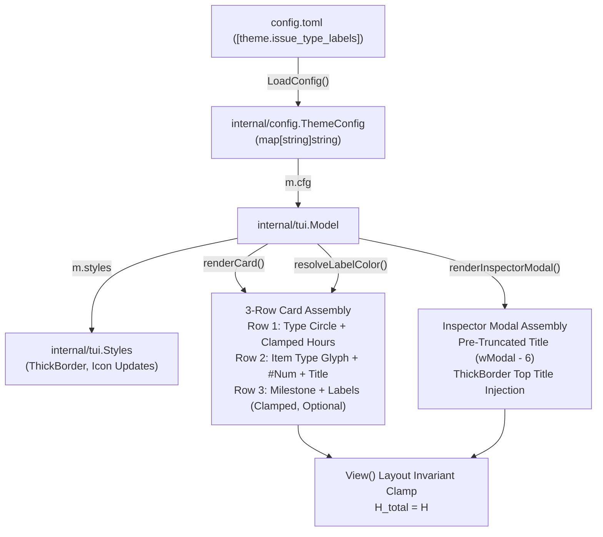

# Look & Feel Overhaul: Thick Borders, Compact Adaptive Cards & Layout Hardening

* **Author:** ejablonski
* **Status:** Implementation-Ready
* **Date:** 2026-11-01

--------------------------------------------------------------------------------

## Overview

This project refines the visual styling, component density, and layout robustness of `gh-terrorizer`. It replaces rounded container borders with `lipgloss.ThickBorder()` (`┏`, `━`, `┓`, `┃`, `┗`, `┛`), eliminates vertical card margins, implements an adaptive 3-row card hierarchy with collapsible metadata and config-driven label-to-color circle indicators while preserving native GitHub item types (Pull Requests, Drafts, Issues), updates the milestone glyph, and guarantees flush top-border alignment in the centered Issue Inspector Modal.

By combining sharp border geometry with collapsible metadata rows, deterministic width truncation, and decoupled label coloring rules, `gh-terrorizer` improves vertical and horizontal information density across constrained developer terminals while preventing layout overflow regressions ($H_{\text{total}} = H$).

--------------------------------------------------------------------------------

## The Problem

1. **Visual Fragmentation from Rounded Borders**: Rounded borders (`lipgloss.RoundedBorder()`) introduce rendering inconsistencies across older or non-standard terminal emulators and anti-aliasing artifacts on custom monospace fonts, producing uneven box-drawing seams.
2. **Suboptimal Vertical Card Density and Excessive Spacing**: Default cards employ unnecessary vertical margins (`MarginBottom(1)`). In standard terminal split panes ($H \le 24$, $h_{\text{avail}} = 18$ lines), $5$-line cards allow only $3$ cards before triggering vertical scroll clipping.
3. **Ambiguous Milestone and Time Tracking Glyphs**: The current milestone icon (``) renders visually as a bug in multiple Nerd Font distributions, creating confusion with defect reports. Furthermore, displaying text tags like `[TRACKING]` on active cards consumes $11$ horizontal cells, crowding narrow columns and risking text wrapping.
4. **Top-Border Alignment Defect in Modal Dialogs**: While [`renderInspectorModal`](file:///home/ejablonski/dev/gh-terrorizer/internal/tui/render.go#L142) already uses character-cell runewidth accounting, long issue titles exceeding modal width cause top-border dash formulas to overflow the container bounds, pushing the right border corner (`┓`) into a second wrapped line.
5. **Layout Fragility Under Component Styling Changes**: Modifying container padding, borders, or margins without hard encapsulation risks reintroducing vertical height overflow ($H_{\text{total}} > H$), which scrolls the Top Bar and column headers out of view.

--------------------------------------------------------------------------------

## Goals

* **G1: Unified Thick Border Aesthetics**: Standardize all primary containers (Kanban columns, cards, and Issue Inspector Modal) on `lipgloss.ThickBorder()`.
* **G2: High-Density 3-Row Cards with Collapsible Metadata & Type Preservation**: Restructure cards into an adaptive 3-row layout (Row 1: circle type indicator + right-aligned time; Row 2: item type glyph + `#<number>` + title; Row 3: milestone + labels). If an issue has neither milestone nor labels, Row 3 is omitted entirely ($h_{\text{inner}} = 2$ lines instead of $3$, $h_{\text{outer}} = 4$ lines instead of $5$).
* **G3: Configurable Label-to-Color Type Indicators**: Introduce a configuration table in `config.toml` (`[theme.issue_type_labels]`) allowing users to map issue labels to circle icon colors (`●`), evaluated case-insensitively with first-match resolution and neutral fallback (`p.Comment`), cleanly separated from domain models.
* **G4: Unambiguous Tracking and Milestone Indicators**: Replace `` with signpost/flag `` (`\uf461`, fallback `[M]`). Remove the text tag `[TRACKING]`, indicating active time tracking by rendering the clock icon (`󱎫`) in green via `m.styles.CardHoursActive`.
* **G5: Flush Modal Top-Border Alignment**: Implement exact cell-width string truncation using [`runewidth.Truncate`](file:///home/ejablonski/dev/gh-terrorizer/internal/tui/render.go) and [`runewidth.StringWidth`](file:///home/ejablonski/dev/gh-terrorizer/internal/tui/render.go) to guarantee the top border corners (`┏`, `┓`) remain strictly flush with outer vertical borders without wrapping.
* **G6: Guaranteed Zero-Overflow Height Invariants**: Enforce strict single-line clamping on all card rows to maintain deterministic card heights ($h_i \in \{4, 5\}$), preserving line budget conservation ($h_{\text{main}} = H - \text{lipgloss.Height}(\text{topBar}) - \text{lipgloss.Height}(\text{bottomBar})$) and preventing the Top Bar from scrolling off screen.

--------------------------------------------------------------------------------

## Non-Goals

* **NG1: Inline Card Title/Label Editing**: Direct in-place editing of issue titles or labels in Kanban columns remains out of scope. External editing continues to be delegated to `$EDITOR` via `tea.ExecProcess`.
* **NG2: Modifications to GraphQL Engine or Timewarrior IPC**: Remote query schemas, optimistic mutation rollback logic, and Timewarrior subprocess IPC remain unchanged.
* **NG3: Nested Bubble Tea Sub-Models**: Retain a single root `tui.Model` with pure layout rendering functions in [`internal/tui/render.go`](file:///home/ejablonski/dev/gh-terrorizer/internal/tui/render.go) rather than introducing stateful sub-models.
* **NG4: Dynamic Card Search and Filtering**: Interactive search filtering via `/` is deferred to a future milestone.

--------------------------------------------------------------------------------

## Critical User Journeys (CUJs)

### CUJ 1: Scanning Tasks with Visual Type Indicators
* **Given**: The user has configured `[theme.issue_type_labels]` with `feature = "#7aa2f7"`, `task = "#e0af68"`, and `bug = "#f7768e"`.
* **When**: The user views a Kanban column containing multiple issues with distinct labels.
* **Then**: Each card displays a thick rectangular border. On Row 1, a colored circle (`●`) appears on the left corresponding to the first matching label (or neutral grey if unmatched), and tracked time appears right-aligned. On Row 2, the entity type glyph (` `, ` `, ` `) distinguishes pull requests and drafts from issues. Cards with neither milestone nor labels render without Row 3, occupying $h_{\text{outer}} = 4$ lines. On standard $H = 24$ terminals ($h_{\text{avail}} = 18$), up to $4$ collapsed cards fit without scrolling ($4 \times 4 = 16 \le 18$); on terminals where $H \ge 26$, $5$ collapsed cards fit ($5 \times 4 = 20 \le 20$).

### CUJ 2: Active Time Tracking on a Card
* **Given**: The user focuses an issue card and presses `t` to begin time tracking.
* **When**: Time tracking starts via Timewarrior.
* **Then**: The Top Bar displays the active tag and running timer. On the card itself, the clock icon (`󱎫`) turns green via `m.styles.CardHoursActive`, and no redundant `[TRACKING]` text is appended, preserving clean spacing across compact columns.

### CUJ 3: Inspecting an Issue in Modal Dialog
* **Given**: The user presses `Enter` or `i` over a focused card with a long title.
* **When**: The Issue Inspector Modal opens at the center of the terminal.
* **Then**: The modal renders with sharp `ThickBorder` edges. The top border embeds `#<number> <title>` truncated to $w_{\text{modal}} - 6$, with right corner `┓` aligned with the right vertical border `┃` across all terminal dimensions.

--------------------------------------------------------------------------------

## Technical Plan (Architecture)

### 1. High-Level Architecture & Subsystem Interactions

The look-and-feel overhaul introduces visual improvements across configuration, styling, and rendering while strictly preserving package isolation:



---

### 2. Configuration Schema & Package Decoupling

In [`internal/config/config.go`](file:///home/ejablonski/dev/gh-terrorizer/internal/config/config.go), extend `ThemeConfig` to store raw label-to-hex mappings without importing domain packages:

```go
type ThemeConfig struct {
    TokyoNightVariant string            `toml:"variant"`
    ShowIcons         bool              `toml:"show_icons"`
    IssueTypeLabels   map[string]string `toml:"issue_type_labels"`
}
```

In `LoadConfig()`:
* Normalize all keys in `IssueTypeLabels` to lowercase upon unmarshaling. This ensures case-insensitive matching in $O(1)$ lookup time per label, avoiding redundant map iterations and runtime string allocations.
* `internal/config` remains a pure leaf package with zero dependencies on [`internal/github`](file:///home/ejablonski/dev/gh-terrorizer/internal/github/client.go).

Presentation color resolution is encapsulated entirely in [`internal/tui/render.go`](file:///home/ejablonski/dev/gh-terrorizer/internal/tui/render.go):
```go
func (m Model) resolveLabelColor(item github.ProjectItem) string {
    fallback := string(m.styles.Palette.Comment)
    if m.cfg == nil || len(m.cfg.Theme.IssueTypeLabels) == 0 || len(item.Labels) == 0 {
        return fallback
    }
    for _, l := range item.Labels {
        if hex, ok := m.cfg.Theme.IssueTypeLabels[strings.ToLower(l.Name)]; ok {
            return hex
        }
    }
    return fallback
}
```

---

### 3. Styling & Thick Border Geometry

In [`internal/tui/styles.go`](file:///home/ejablonski/dev/gh-terrorizer/internal/tui/styles.go):
1. **Container Borders**: Replace `lipgloss.RoundedBorder()` with `lipgloss.ThickBorder()` across `ColumnBox`, `ColumnBoxFocused`, `CardNormal`, `CardFocused`, and `ModalFrame`. Remove `MarginBottom(1)` from all card styles (`CardNormal`, `CardFocused`, `CardMoving`) to achieve zero-gap vertical card packing.
2. **Milestone Icon**: In `Icon(name string)`, update `"milestone"` to return `" "` when icons are enabled, with `"[M]"` fallback when icons are disabled.
3. **Type Circle Icon**: Add `"type_circle"` returning `"● "` (`\u25cf `) when icons are enabled, with `"* "` fallback when icons are disabled.
4. **Tracking Clock Style**: Centralize active timer styling in `CardHoursActive` with foreground `p.Green`. Numeric elapsed hours remain styled with `CardHours` (`p.Comment`). The textual `[TRACKING]` indicator is eliminated completely.

---

### 4. 3-Row Card Rendering Mechanics & Width Geometry

In [`internal/tui/render.go`](file:///home/ejablonski/dev/gh-terrorizer/internal/tui/render.go), rewrite `(m Model) renderCard`:

* **Coordinate Definition**: Given outer card width $w_{\text{outer}}$, the inner content width is:
  $$w_{\text{inner}} = w_{\text{outer}} - 2 \times \text{border} - 2 \times \text{padding} = w_{\text{outer}} - 4$$
* **Row 1 (Header Strip)**:
  * Left: `circleGlyph := m.styles.Icon("type_circle")` styled with `lipgloss.NewStyle().Foreground(lipgloss.Color(m.resolveLabelColor(item)))`.
  * Right: Tracked time badge. If `m.activeTimerItemID == item.ID`, the clock icon is styled with `m.styles.CardHoursActive.Render(m.styles.Icon("timer"))` followed by `m.styles.CardHours.Render(timew.FormatHours(item.HoursSpent))`. Otherwise: `m.styles.CardHours.Render(m.styles.Icon("timer") + timew.FormatHours(item.HoursSpent))`.
  * If $w_{\text{inner}} < 10$, the time badge is suppressed to avoid overflow. Otherwise, left and right elements are joined with:
    $$\text{gap} = \max(1, w_{\text{inner}} - \text{lipgloss.Width}(\text{left}) - \text{lipgloss.Width}(\text{right}))$$
    and assembled as `left + strings.Repeat(" ", gap) + right`. Because $w_{\text{inner}} \ge 10$ and maximum badge width is $9$, this fits within $w_{\text{inner}}$ without slicing ANSI sequences.
* **Row 2 (Title Strip & Domain Type Glyph)**:
  * Distinguishes item types:
    $$\text{typeIcon} = \begin{cases} \text{m.styles.Icon("pr")} & \text{if } \text{item.Type} == \text{"PULL\_REQUEST"} \\ \text{m.styles.Icon("draft")} & \text{if } \text{item.Type} == \text{"DRAFT\_ISSUE"} \\ \text{m.styles.Icon("issue")} & \text{otherwise} \end{cases}$$
  * Formats prefix string `prefix`: if `typeIcon == "#"`, format as `fmt.Sprintf("#%d", item.Number)`; otherwise `fmt.Sprintf("%s#%d", typeIcon, item.Number)`. Because `CardNumber` has `MarginRight(1)`, no trailing whitespace is added to `prefix`.
  * Computes available title width $w_{\text{avail}} = \max(0, w_{\text{inner}} - \text{lipgloss.Width}(\text{m.styles.CardNumber.Render}(\text{prefix})))$.
  * Pre-truncates the raw unstyled title: `truncTitle = runewidth.Truncate(item.Title, w_avail, "...")`.
  * Assembles Row 2: `m.styles.CardNumber.Render(prefix) + m.styles.CardTitle.Render(truncTitle)`. This prevents ANSI escape code corruption during truncation.
* **Row 3 (Metadata Strip - Collapsible)**:
  * Rendered **only** if `item.Milestone != nil || len(item.Labels) > 0`.
  * Formats milestone badge (` <title>`) and label badges horizontally joined (`row3Joined`).
  * Clamped to $w_{\text{inner}}$ using ANSI-aware truncation `ansi.Truncate(row3Joined, w_inner, "...")` from `github.com/charmbracelet/x/ansi` to guarantee single-line display without corrupting closing escape codes.
  * If both milestone and labels are absent, Row 3 is omitted entirely.
* **Resulting Card Dimensions**:
  * Collapsed card (no metadata): $h_{\text{inner}} = 2$ lines, $h_{\text{outer}} = 4$ lines.
  * Expanded card (with metadata): $h_{\text{inner}} = 3$ lines, $h_{\text{outer}} = 5$ lines.

---

### 5. Modal Top-Border Alignment & Container Width

In `renderInspectorModal`:
* Pre-truncate the unstyled header title:
  $$\text{truncTitle} = \text{runewidth.Truncate}(\text{headerTitle}, w_{\text{modal}} - 6, \text{"..."})$$
* Assemble top border with guaranteed non-negative dashes:
  $$\text{remainingDashes} = \max(1, w_{\text{modal}} - \text{runewidth.StringWidth}(\text{truncTitle}) - 5)$$
  ```go
  topBorder := "┏━ " + truncTitle + " " + strings.Repeat("━", remainingDashes) + "┓"
  ```
* Render `ModalFrame` with inner width $w_{\text{modal}} - 2$:
  ```go
  modalBox := m.styles.ModalFrame.Width(wModal - 2).Render(content)
  ```
* Because `ModalFrame` has `Border(lipgloss.ThickBorder())` ($2$ cells), setting `Width(wModal - 2)` makes every line of `modalBox` exactly $w_{\text{modal}}$ cells wide ($w_{\text{inner}} + 2 = w_{\text{modal}}$). Replacing `lines[0]` with `topBorder` guarantees that the top corners (`┏`, `┓`) align flush with vertical side borders (`┃`) without horizontal offset or drift.

---

### 6. Dynamic Height & Zero-Overflow Invariants

* Column boxes set inner height strictly to $h_{\text{inner}} = h_{\text{col}} - 2$.
* Card packing in columns sums card heights $O(N)$ with variable card heights $h_i \in \{4, 5\}$ lines:
  * When $i > 0$ and remaining height is insufficient to render card $i$, reserve $1$ line for `ScrollIndicator` (`↓ %d more`).
  * When top offset $> 0$, reserve $1$ line for top `ScrollIndicator` (`↑ %d more`).
* Safety clamping in `renderColumn`, `renderSingleColumnTabbed`, and `Model.View()` ensures total output lines strictly equal terminal height $H$ across all dimensions ($H_{\text{total}} = H$).

--------------------------------------------------------------------------------

## Alternatives Considered

### Alternative 1: Hardcoded Label & Title Prefix Heuristics
* **Description**: Inferring issue types directly from conventional commit prefixes (`feat:`, `fix:`) in issue titles or hardcoded label strings in Go source code.
* **Why Rejected**: GitHub repository labeling conventions vary across teams. Hardcoding strings in Go prevents customization. A dedicated `[theme.issue_type_labels]` mapping table in `config.toml` provides flexible user configuration with zero code changes.

### Alternative 2: Static Fixed 3-Row Cards vs Dense 2-Row Cards
* **Description**: Always rendering 3 content rows for every card, leaving Row 3 blank when an issue has no assigned milestone or labels.
* **Why Rejected**: On standard 24-row terminals ($H = 24$), a column has available card height $h_{\text{avail}} = 18$ lines. Fixed 3-row cards occupy $5$ lines each, limiting visible column capacity to $3$ cards. Collapsing Row 3 when empty reduces card height to $4$ lines, allowing $4$ cards to fit without scrolling.

### Alternative 3: Retaining Rounded Borders with Padding Adjustments
* **Description**: Keeping `lipgloss.RoundedBorder()` while tightening card margins.
* **Why Rejected**: Rounded corner glyphs (`╭`, `╰`, `╮`, `╯`) exhibit anti-aliasing artifacts and visual cell gaps across several terminal emulators and non-standard monospace fonts. Transitioning to `lipgloss.ThickBorder()` (`┏`, `┗`, `┓`, `┛`) establishes uniform box-drawing alignment across VT100/xterm emulators.

### Alternative 4: Appended Text `[TRACKING]` Badge on Cards
* **Description**: Displaying the string `[TRACKING]` next to the hours badge on the active card.
* **Why Rejected**: The text badge consumes $11$ character cells (` [TRACKING]`). On narrow columns ($w_{\text{inner}} \approx 21$), rendering `● 1.50h [TRACKING]` consumes $19$ cells, risking horizontal overflow or text wrapping. Changing the clock icon (`󱎫`) to green (`p.Green`) provides an unmistakable visual indicator while consuming $0$ extra columns.

### Alternative 5: Single-Line Condensed Cards
* **Description**: Packing issue title, type icon, hours, and labels onto a single dense line per card.
* **Why Rejected**: Single-line cards severely truncate issue titles to $10\text{ to }15$ characters on typical column widths, making task identification difficult without opening the Issue Inspector Modal. The collapsible 3-row structure preserves full-width title visibility on Row 2 while remaining compact.

--------------------------------------------------------------------------------

## Detailed Implementation Plan

The implementation is structured into 4 sequential phases, ensuring the codebase remains compilable (`go build ./...`) and testable (`go test ./...`) after each step.

### Phase 1: Configuration Schema & Label Mapping

#### 1. `internal/config/config.go` (Modify)
* **Scope**: Configuration structs & loading normalization.
* **Rationale**: Add `IssueTypeLabels map[string]string` to `ThemeConfig` to support user-configurable label mappings without coupling to domain packages.
* **Changes**:
  * Add field `IssueTypeLabels map[string]string` with tag `toml:"issue_type_labels"`.
  * In `DefaultConfig()`, initialize `IssueTypeLabels` as `make(map[string]string)`.
  * In `LoadConfig()`, normalize all keys in `cfg.Theme.IssueTypeLabels` to lowercase:
    ```go
    normalized := make(map[string]string, len(cfg.Theme.IssueTypeLabels))
    for k, v := range cfg.Theme.IssueTypeLabels {
        normalized[strings.ToLower(k)] = v
    }
    cfg.Theme.IssueTypeLabels = normalized
    ```

#### 2. `internal/config/config_test.go` (Modify)
* **Scope**: Configuration unit test coverage.
* **Rationale**: Verify TOML parsing, case-normalization, and default handling.
* **Changes**:
  * Test TOML string containing `[theme.issue_type_labels]` unmarshaling into map.
  * Verify keys are normalized to lowercase on load.

---

### Phase 2: Styling Tokens, Thick Borders & Iconography

#### 1. `internal/tui/styles.go` (Modify)
* **Scope**: Visual styling definitions & glyph mapping.
* **Rationale**: Adopt `lipgloss.ThickBorder()`, remove vertical card bottom margins, update milestone icon, and configure green tracking clock style.
* **Changes**:
  * Update `ColumnBox`: `Border(lipgloss.ThickBorder()).BorderForeground(p.BorderInactive).Padding(0, 1)`.
  * Update `ColumnBoxFocused`: `Border(lipgloss.ThickBorder()).BorderForeground(p.Blue).Padding(0, 1)`.
  * Update `CardNormal`: `Border(lipgloss.ThickBorder()).BorderForeground(p.BorderInactive).Padding(0, 1)`. (Remove `MarginBottom(1)`).
  * Update `CardFocused`: `Border(lipgloss.ThickBorder()).BorderForeground(p.Blue).Background(p.BgHighlight).Padding(0, 1)`. (Remove `MarginBottom(1)`).
  * Update `CardMoving`: `Border(lipgloss.DoubleBorder()).BorderForeground(p.Purple).Background(p.BgHighlight).Padding(0, 1)`. (Remove `MarginBottom(1)`).
  * Update `ModalFrame`: `Border(lipgloss.ThickBorder()).BorderForeground(p.Blue).Padding(0, 1)`.
  * Update `CardHoursActive`: Foreground `p.Green` without background highlights.
  * Update `Icon(name string)`:
    * `"milestone"`: change ` ` to ` ` (`\uf461`), fallback `[M]`.
    * `"type_circle"`: return `● ` (`\u25cf `), fallback `* `.

#### 2. `internal/tui/model_test.go` (Modify)
* **Scope**: Immediate icon unit test updates to maintain testability after Phase 2.
* **Rationale**: Guarantee `go test ./...` passes cleanly after Phase 2 before starting Phase 3.
* **Changes**:
  * In `TestStyles_Icons`, update assertion for `"milestone"` to expect `" "` (with icons) and `"[M]"` (without icons).
  * In `TestStyles_Icons`, add assertions for `"type_circle"`: expect `"● "` (with icons) and `"* "` (without icons).

---

### Phase 3: Pure Card Rendering & Modal Frame Alignment

#### 1. `internal/tui/render.go` (Modify)
* **Scope**: Card and modal layout rendering functions.
* **Rationale**: Implement the 3-row card hierarchy with collapsible Row 3, entity type glyph preservation, ANSI-safe title pre-truncation, and exact character-cell modal top-border slicing.
* **Changes**:
  * Add helper method:
    ```go
    func (m Model) resolveLabelColor(item github.ProjectItem) string {
        fallback := string(m.styles.Palette.Comment)
        if m.cfg == nil || len(m.cfg.Theme.IssueTypeLabels) == 0 || len(item.Labels) == 0 {
            return fallback
        }
        for _, l := range item.Labels {
            if hex, ok := m.cfg.Theme.IssueTypeLabels[strings.ToLower(l.Name)]; ok {
                return hex
            }
        }
        return fallback
    }
    ```
  * In `(m Model) renderCard(item github.ProjectItem, isFocused bool, width int) string`:
    * Inner content width is $w_{\text{inner}} = \text{width} - 4$.
    * Initialize card container style with $w_{\text{inner}}$ so Lip Gloss outer width equals `width`:
      ```go
      wInner := width - 4
      cardStyle := m.styles.CardNormal.Width(wInner)
      if isFocused {
          if m.movingCard {
              cardStyle = m.styles.CardMoving.Width(wInner)
          } else {
              cardStyle = m.styles.CardFocused.Width(wInner)
          }
      }
      ```
    * **Row 1**:
      * Left: `left := lipgloss.NewStyle().Foreground(lipgloss.Color(m.resolveLabelColor(item))).Render(m.styles.Icon("type_circle"))`.
      * Right: Tracked time badge. If `m.activeTimerItemID == item.ID`:
        `right := m.styles.CardHoursActive.Render(m.styles.Icon("timer")) + m.styles.CardHours.Render(timew.FormatHours(item.HoursSpent))`
        Otherwise:
        `right := m.styles.CardHours.Render(m.styles.Icon("timer") + timew.FormatHours(item.HoursSpent))`
      * If $w_{\text{inner}} < 10$, suppress time badge: `row1 := left`.
      * Otherwise pad with visual cell calculation:
        `gap := max(1, wInner - lipgloss.Width(left) - lipgloss.Width(right))`
        `row1 := left + strings.Repeat(" ", gap) + right`
    * **Row 2**:
      * Determine item type glyph (`Icon("pr")`, `Icon("draft")`, or `Icon("issue")`).
      * Format prefix without trailing space (since `CardNumber` has `MarginRight(1)`):
        ```go
        prefix := fmt.Sprintf("%s#%d", typeIcon, item.Number)
        if typeIcon == "#" {
            prefix = fmt.Sprintf("#%d", item.Number)
        }
        ```
      * Calculate available title space from rendered prefix:
        $w_{\text{avail}} = \max(0, w_{\text{inner}} - \text{lipgloss.Width}(\text{m.styles.CardNumber.Render}(\text{prefix})))$
      * Pre-truncate the unstyled title: `truncTitle := runewidth.Truncate(item.Title, wAvail, "...")`.
      * Assemble Row 2 without slicing ANSI escape codes: `row2 := m.styles.CardNumber.Render(prefix) + m.styles.CardTitle.Render(truncTitle)`.
    * **Row 3 (Conditional)**:
      * Rendered only if `item.Milestone != nil || len(item.Labels) > 0`.
      * Assemble milestone badge (` <title>`) and label badges horizontally joined:
        `row3Joined := lipgloss.JoinHorizontal(lipgloss.Left, badges...)`
      * Clamp using ANSI-aware truncation `ansi.Truncate(row3Joined, wInner, "...")` from `github.com/charmbracelet/x/ansi` to preserve closing escape codes and prevent multi-line wrapping.
      * Omitted entirely if both are absent.
    * Combine rows with `lipgloss.JoinVertical(lipgloss.Left, rows...)` and apply `cardStyle.Render(...)`.
  * In `(m Model) renderInspectorModal(width, height int) string`:
    * Render `ModalFrame` with width `wModal - 2`:
      `modalBox := m.styles.ModalFrame.Width(wModal - 2).Render(content)`
    * Reuse existing truncated `headerTitle` (already truncated to `availWidth` at line 142).
    * Compute `remainingDashes := max(1, wModal - runewidth.StringWidth(headerTitle) - 5)`.
    * Assemble: `topBorder := "┏━ " + headerTitle + " " + strings.Repeat("━", remainingDashes) + "┓"`.
    * Replace `lines[0]` with `lipgloss.NewStyle().Foreground(m.styles.Palette.Blue).Render(topBorder)`.

---

### Phase 4: Verification, Test Suite Updates & Documentation

#### 1. `internal/tui/model_test.go` (Modify)
* **Scope**: Unit test updates and comprehensive test cases.
* **Rationale**: Maintain $> 85\%$ test coverage under race detection and ensure no visual regression.
* **Changes**:
  * Import `"github.com/charmbracelet/x/ansi"` for ANSI stripping.
  * Add `TestCard_CollapsibleRow3`:
    * Create card without milestone/labels -> assert rendered height is $4$ lines outer.
    * Create card with milestone or labels -> assert rendered height is $5$ lines outer.
  * Add `TestCard_LabelColorResolution`:
    * Verify nil `m.cfg` safely falls back to neutral gray without panic.
    * Configure `[theme.issue_type_labels]` with multiple entries.
    * Verify first matching label color is applied to the circle indicator.
    * Verify fallback color is applied when no labels match.
  * Add `TestCard_DomainTypeIcons`:
    * Verify PRs display ` `, Drafts display ` `, and standard Issues display ` `.
  * Add `TestCard_RowClamping`:
    * Verify long labels, long milestones, or narrow column widths never wrap or exceed $h_{\text{outer}} \in \{4, 5\}$.
  * Add `TestModal_ThickBorderAlignment`:
    * Search lines from `strings.Split(m.renderInspectorModal(width, height), "\n")` for the top border line:
      ```go
      var topBorderLine string
      for _, line := range strings.Split(rendered, "\n") {
          trimmed := strings.TrimSpace(ansi.Strip(line))
          if strings.HasPrefix(trimmed, "┏") {
              topBorderLine = trimmed
              break
          }
      }
      ```
    * Assert `strings.HasPrefix(topBorderLine, "┏")` and `strings.HasSuffix(topBorderLine, "┓")`.
    * Assert `runewidth.StringWidth(topBorderLine) == wModal`.
  * Verify all existing dynamic geometry and layout overflow tests pass cleanly.

#### 2. `internal/tui/README.md` (Modify)
* **Scope**: Subsystem architectural documentation.
* **Rationale**: Update component style tokens, border specifications, collapsible card invariants, and color resolution rules.

#### 3. `README.md` (Modify)
* **Scope**: User-facing documentation.
* **Rationale**: Update workstation ASCII diagrams with `ThickBorder` glyphs, document `[theme.issue_type_labels]` in the configuration guide, and illustrate collapsible 3-row cards.

#### 4. `CHANGELOG.md` (Modify)
* **Scope**: Changelog updates.
* **Rationale**: Record look-and-feel improvements under `[Unreleased]` following Keep a Changelog.
