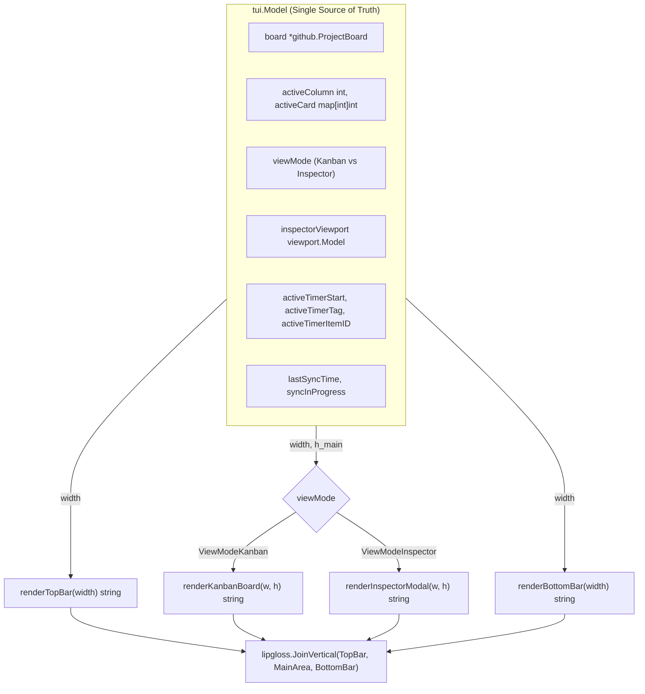
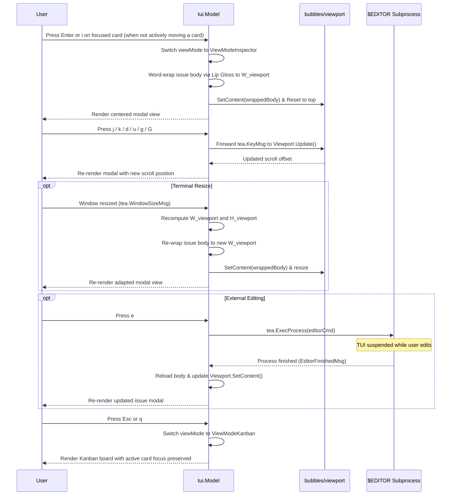
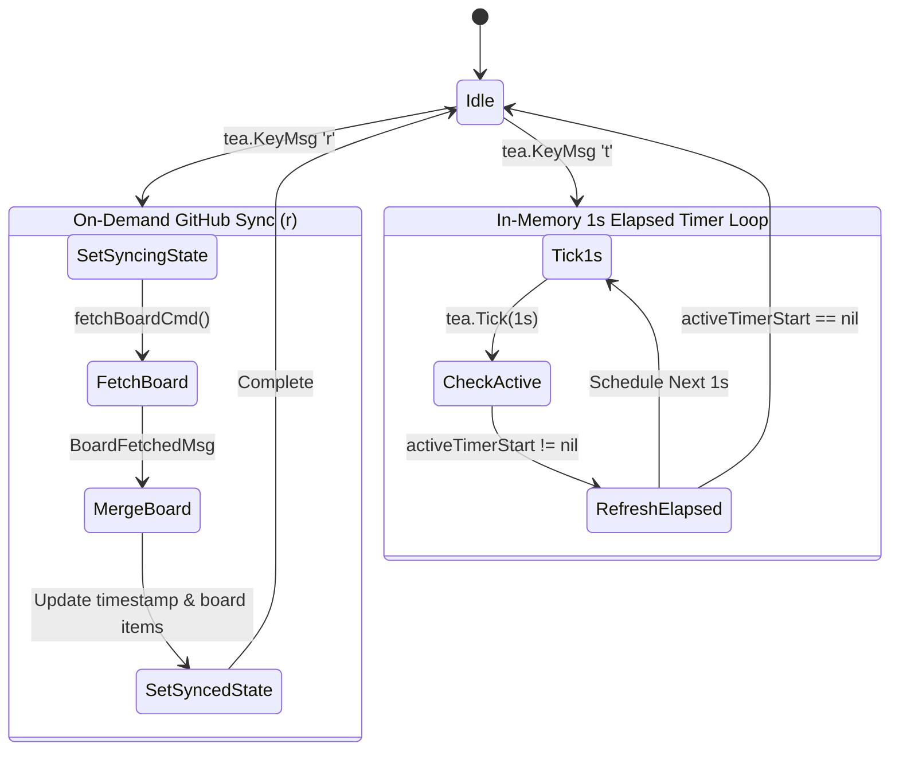
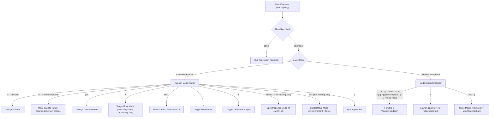

# 3-Tier Terminal Workstation & Issue Inspector Modal

* **Author:** ejablonski
* **Status:** Approved
* **Date:** 2026-10-31

--------------------------------------------------------------------------------

## Overview

This project evolves `gh-terrorizer` from a single-screen Kanban board into a structured 3-tier terminal workstation inspired by Lazygit. The screen layout is dynamically partitioned into three vertical tiers: a Top Bar providing continuous session and time-tracking context, an adaptable Main Application Area displaying either the multi-column Kanban board or an active Issue Inspector Modal, and a Bottom Bar rendering contextual navigation shortcuts and notifications.

By centralizing issue details in a scrollable modal view and exposing session-wide Timewarrior status at a glance, developers can inspect comprehensive issue details, read full descriptions, and track effort without leaving their terminal session or compromising board visibility.

--------------------------------------------------------------------------------

## The Problem

1. **Limited Card Display Area in Kanban View**: Kanban cards in the terminal have limited display area. Long issue descriptions, multi-line checklists, and complete metadata fields cannot fit into compact column cards without overflowing or cluttering the board view.
2. **Context Fragmentation During Deep Inspection**: When a developer needs to read the complete context of an issue, verify assigned milestones, or check tracked time, they must either open a browser tab or exit the terminal workflow.
3. **Continuous In-Session Time Tracking Visibility**: Time tracking requires active awareness. When a Timewarrior timer is running, developers need continuous visibility into the active tag and elapsed duration without issuing separate CLI commands (`timew`).
4. **Layout Fragility Across Varying Terminal Dimensions**: Terminal window resizing often causes border clipping or layout fragmentation when UI components lack strict, height-conserving vertical coordinate boundaries that adapt to line wrapping on narrow terminals.

--------------------------------------------------------------------------------

## Goals

* **G1: 3-Tier Adaptive Vertical Layout**: Establish a dynamic, height-conserving layout where the Top Bar, Main Application Area, and Bottom Bar adapt cleanly to terminal height $H$ ($h_{\text{main}} = H - \text{Height}(\text{topBar}) - \text{Height}(\text{bottomBar})$), preventing vertical jitter or border clipping even on narrow screens.
* **G2: Ambient Time and Session Status**: Provide a persistent Top Bar displaying the repository name, active GitHub project title, live in-memory elapsed duration for active Timewarrior sessions, and on-demand synchronization status.
* **G3: Focused Issue Inspector Modal**: Provide an on-demand centered modal view triggered by `Enter` or `i` over a focused card, replacing the board view in the main tier and embedding a scrollable viewport (`bubbles/viewport`) with Lip Gloss word-wrapping for issue body text, metadata badges, and tracked hours.
* **G4: Non-Blocking Ergonomic Navigation**: Enable modal viewport scrolling via `j`/`k`, modal dismissal via both `Esc` and `q` returning to the exact prior card, and external `$EDITOR` launching via `e`.
* **G5: Context-Sensitive Action Hints**: Render pure-function keybinding strips in the Bottom Bar that adapt dynamically between board navigation and modal inspection.

--------------------------------------------------------------------------------

## Non-Goals

* **NG1: Rich Markdown Styling via Glamour**: Glamour markdown AST parsing is deferred to eliminate external dependencies, prevent ANSI sequence truncation in viewports, and keep rendering latency $< 1\text{ ms}$.
* **NG2: Automated Periodic Background Polling**: Periodic background polling for GitHub and Timewarrior is excluded to eliminate unnecessary battery/CPU drain, rate-limit consumption, and state-merge races; synchronization remains strictly on demand via `r` or user interaction.
* **NG3: In-Board Card Search and Label Filtering**: Interactive filtering via `/` is deferred to a future development milestone.
* **NG4: Multi-Project Workspace Switching**: Navigating between multiple GitHub projects within a single session remains out of scope.
* **NG5: In-Place Text Editing**: Direct inline editing within the modal viewport is not supported; external editing is delegated to `$EDITOR` via `tea.ExecProcess`.

--------------------------------------------------------------------------------

## Open Questions

* **OQ1 (Resolved)**: Exit semantics in modal mode: pressing either `Esc` or `q` dismisses the modal and returns focus to the Kanban board. Quitting the application via `q` is active strictly in `ViewModeKanban`.

--------------------------------------------------------------------------------

## Critical User Journeys (CUJs)

### CUJ 1: Inspecting an Issue Description and Metadata
* **Given**: The user has launched `gh-terrorizer` and navigated the Kanban board to an issue card using `h`/`j`/`k`/`l` (when not actively moving a card). If the selected column is empty (`m.SelectedItem() == nil`), pressing `Enter` or `i` sets a transient notification toast (`m.toast = "No card selected"`) without opening the modal.
* **When**: The user presses `Enter` or `i` over a valid card.
* **Then**: The centered Issue Inspector Modal replaces the Kanban board in the main tier, displaying state, milestone, tracked hours, and word-wrapped issue body text in a viewport. Navigation keys (`j`/`k`) scroll the body text vertically. The Bottom Bar updates to display modal-specific key hints (`j/k: scroll • e: edit • Esc/q: back`).

### CUJ 2: Dismissing the Inspector Modal
* **Given**: The Issue Inspector Modal is open and scrolled to a specific position in the issue body.
* **When**: The user presses `Esc` or `q`.
* **Then**: The modal closes immediately. The full Kanban board is rendered in the main tier with previous column and card selections completely preserved. The Bottom Bar reverts to board navigation keybindings.

### CUJ 3: Monitoring Active Timewarrior Tracking
* **Given**: The user has started time tracking on a card by pressing `t`.
* **When**: The user continues navigating the board or reading issue cards.
* **Then**: The Top Bar displays an active tag indicator with elapsed time updated every second via the in-memory timer tick with zero external subprocess calls.

### CUJ 4: On-Demand Project Synchronization
* **Given**: Remote changes have occurred on GitHub Projects v2 while the board is displayed.
* **When**: The user presses `r`.
* **Then**: The Top Bar sync indicator transitions to syncing state, executes an asynchronous project board fetch, updates column items, and displays the refreshed timestamp without resetting active cursor coordinates.

--------------------------------------------------------------------------------

## Technical Plan (Architecture)

### 1. High-Level Architecture & 3-Tier Layout Geometry

The application layout is dynamically partitioned into three non-overlapping vertical tiers. Total terminal height $H$ is conserved across all frames:

$$h_{\text{main}} = H - \text{lipgloss.Height}(\text{topBar}) - \text{lipgloss.Height}(\text{bottomBar})$$
$$h_{\text{content}} = h_{\text{main}} - 2 \quad (\text{Kanban column inner content height})$$

```text
┌────────────────────────────────────────────────────────────────────────────────────────┐
│ 󰄶 gh-terrorizer │ ejablonski/gh-terrorizer #1 │ 󱎫 gh-42 [01:23:45] │ 󰄬 Synced (r: sync) │  <- Top Bar
├────────────────────────────────────────────────────────────────────────────────────────┤
│ ╭─ Todo (3) ────╮ ╭─ In Progress (2) ─╮ ╭─ Done (5) ─────────────────────────────────╮ │
│ │  #10 Task 1  │ │ ┏━━━━━━━━━━━━━━━┓ │ │  #05 Setup Repo                            │ │  <- Main Area
│ │  󱎫 1.00h      │ │ ┃  #42 Task 3  ┃ │ │  󱎫 0.50h                                    │ │     (h_main rows)
│ │ ╭───────────╮ │ │ ┃  󱎫 0.50h      ┃ │ ╰────────────────────────────────────────────╯ │     Kanban or Modal
│ │ │  #20 Task│ │ │ ┗━━━━━━━━━━━━━━━┛ │                                                │
│ │ ╰───────────╯ │ ╰───────────────────╯                                                │
│ ╰───────────────╯                                                                      │
├────────────────────────────────────────────────────────────────────────────────────────┤
│ h/l: cols • j/k: cards • m: move • H/L: shift • t: timer • r: sync • Enter/i: inspect • q: quit │  <- Bottom Bar
└────────────────────────────────────────────────────────────────────────────────────────┘
```

On compact viewports ($W < 85$), the Top Bar truncates the owner prefix (`gh-terrorizer #1`) and shortens the sync badge (`󰄬 Synced`), while the Bottom Bar renders a condensed keybinding strip, preventing multi-line bar wrapping.

When an issue is inspected (`Enter` or `i`), the Main Application Area replaces the Kanban view with a centered modal box:

```text
┌────────────────────────────────────────────────────────────────────────────────────────┐
│ 󰄶 gh-terrorizer │ ejablonski/gh-terrorizer #1 │ 󱎫 gh-42 [01:23:45] │ 󰄬 Synced (r: sync) │
├────────────────────────────────────────────────────────────────────────────────────────┤
│                   ╭─ Issue #42: Authentication Token Refresh ────────╮                 │
│                   │ State: OPEN  │ Milestone: v1.0 │ Tracked: 2.50h  │                 │
│                   ├──────────────────────────────────────────────────┤                 │
│                   │ Description:                                     │                 │
│                   │ When the access token expires, the client fails  │                 │
│                   │ to refresh credentials against GitHub OAuth API. │                 │
│                   │ Steps to reproduce:                              │                 │
│                   │  1. Invalidate cached token.                     │                 │
│                   │  2. Run query command.                           │                 │
│                   │                                            [28%] │                 │
│                   ╰──────────────────────────────────────────────────╯                 │
├────────────────────────────────────────────────────────────────────────────────────────┤
│ j/k: scroll • d/u: half page • g/G: top/bottom • e: edit in $EDITOR • Esc/q: back      │
└────────────────────────────────────────────────────────────────────────────────────────┘
```

---

### 2. Component Architecture & Pure Function Rendering

To prevent state desynchronization and message-bubbling boilerplate inherent in nested Bubble Tea models, `gh-terrorizer` maintains a single root `tui.Model`. Component rendering is performed via pure, deterministic functions:



* **`renderTopBar(width int) string`**:
  * Extracts project owner/repo, project title, active timer status from `m.activeTimerTag` and `m.activeTimerStart`, and sync status.
  * Formats right-aligned or space-between layout using Lip Gloss styling.
* **`renderBottomBar(width int) string`**:
  * Inspects `m.viewMode` and `m.movingCard` to return context-specific keybinding strips and transient status notifications (`m.toast` or error messages).
* **`renderInspectorModal(width, height int) string`**:
  * Computes modal bounding box dimensions with lower-bound clamps:
    $$W_{\text{modal}} = \max(16, \min(W - 2, \lfloor 0.85 \times W \rfloor))$$
    $$H_{\text{modal}} = \max(7, \min(\text{height} - 2, \lfloor 0.85 \times \text{height} \rfloor))$$
  * Computes viewport dimensions:
    $$W_{\text{viewport}} = \max(10, W_{\text{modal}} - 4)$$
    $$H_{\text{viewport}} = \max(2, H_{\text{modal}} - 5)$$
  * Formats the header text (e.g. `fmt.Sprintf("#%d %s", item.Number, item.Title)`) and truncates it to available border width $W_{\text{avail}} = \max(0, W_{\text{modal}} - 6)$ using `runewidth.Truncate(header, W_avail, "...")` before rendering into the top border frame, preventing outer frame fracture on long issue titles. If `strings.TrimSpace(item.Body) == ""`, renders an italicized placeholder `No description provided.` using `m.styles.EmptyNotice` inside the viewport.
  * Renders metadata header strip (1 line, with issue title embedded in the top border frame), horizontal divider (1 line), embedded `bubbles/viewport` content ($H_{\text{viewport}}$ lines), and footer (1 line) with zero vertical padding (`Padding(0, 1)`), conserving exact modal height.
  * Centers the rendered modal box within the main area dimensions using `lipgloss.Place()`.

---

### 3. Viewport Integration & Word-Wrapping Mechanics

The Issue Inspector Modal embeds a `bubbles/viewport.Model` to handle vertical text scrolling:



* **Word-Wrapping**: Content is wrapped strictly at $W_{\text{viewport}}$ using `lipgloss.NewStyle().Width(w).Render(text)`.
* **Zero Horizontal Scroll**: Viewport horizontal panning is disabled. This eliminates ANSI slicing artifacts and guarantees all lines fit cleanly within modal borders.
* **Scroll Navigation Keys**:
  * `j` / `k` / `down` / `up`: Scroll 1 line down / up.
  * `d` / `u` / `pgdown` / `pgup` / `space`: Scroll half page or full page down / up.
  * `g` / `G` / `home` / `end`: Jump to top / bottom of document.

---

### 4. Timers & Synchronization Model



* **In-Session Elapsed Timer ($1\text{ s}$)**:
  * When time tracking is toggled on via `t`, `m.activeTimerStart = time.Now()`, `m.activeTimerTag = tag`, and `m.activeTimerItemID = item.ID`.
  * The existing in-memory 1-second ticker (`TickMsg`) drives elapsed duration calculation (`time.Since(m.activeTimerStart)`) with $0$ external subprocess calls.
* **On-Demand GitHub Synchronization (`r`)**:
  * Pressing `r` sets `m.syncInProgress = true` and fires the existing `fetchBoardCmd()`.
  * When `BoardFetchedMsg` returns, `m.board` is updated while preserving active column and card selection indices (`m.activeColumn`, `m.activeCard`).
  * If `m.viewMode == ViewModeInspector` upon `BoardFetchedMsg` arrival, the active card is re-queried by ID from the refreshed board: if modified, the body is re-wrapped and `m.inspectorViewport.SetContent()` is updated; if deleted remotely, the modal closes and `m.toast = "Card removed remotely"` is displayed.

---

### 5. Key Routing & State Isolation



--------------------------------------------------------------------------------

## Alternatives Considered

### Alternative 1: Permanent Side-by-Side Split View ($65\% / 35\%$)

* **Pros**: Displays card details continuously without requiring explicit modal open or close keypresses, closely matching the default Lazygit commit/diff inspection layout.
* **Cons**: On standard developer terminal displays ($80 \le W \le 120$), allocating $35\%\text{ to }50\%$ of width to an inspector panel leaves only $40\text{ to }60$ columns for the Kanban board. With a minimum column width threshold of $25$ characters, the board is constrained to $1\text{ or }2$ visible columns, inducing continuous horizontal scrolling and obscuring overall project state.
* **Reason for Rejection**: Replacing the board view with a centered modal preserves full board visibility during regular column navigation and provides $80\%\text{ to }85\%$ screen area ($W \ge 70\text{ columns}$) when reading comprehensive issue descriptions.

### Alternative 2: Rich Markdown Styling Engine (Glamour)

* **Pros**: Provides terminal markdown styling, including rendered code blocks, table borders, and styled blockquotes.
* **Cons**: Markdown AST parsing and ANSI styling via Glamour require $10\text{ to }50\text{ ms}$ per call. Calling Glamour dynamically or reflowing rendered text during viewport scrolling creates frame drops and UI stutter. Furthermore, slicing ANSI sequences across viewport line boundaries risks corrupting terminal state.
* **Reason for Rejection**: Lip Gloss word-wrapping achieves $< 1\text{ ms}$ render latency, introduces $0$ additional external dependencies, and eliminates ANSI slicing risks entirely.

### Alternative 3: Automated Periodic Background Polling

* **Pros**: Keeps remote GitHub issue state synchronized without requiring explicit user action.
* **Cons**: Consumes GitHub API rate limits ($60\text{ queries/hour}$), spawns repeated external subprocesses for Timewarrior, risks background state-merge race conditions if the user is in the middle of dragging a card (`m.movingCard`), and drains laptop battery.
* **Reason for Rejection**: On-demand synchronization via `r` gives the user explicit control over network operations, avoids optimistic state races, and maintains zero background API and subprocess churn.

### Alternative 4: Nested Bubble Tea Child Sub-Models

* **Pros**: Encapsulates `HeaderModel`, `KanbanModel`, `InspectorModel`, and `FooterModel` into independent components with their own `Init`, `Update`, and `View` methods.
* **Cons**: Introduces message-forwarding boilerplate, requires manual event bubbling for window resizing, and creates potential state divergence between sub-models.
* **Reason for Rejection**: A unified root model paired with pure rendering functions (`renderTopBar`, `renderBottomBar`, `renderInspectorModal`) ensures a single source of truth, deterministic view generation, and simplified unit testing.

### Alternative 5: Immediate In-Board Card Search and Label Filtering (`/`)

* **Pros**: Allows users to quickly locate cards across large multi-column boards by typing search queries.
* **Cons**: Introduces textinput state handling, column index filtering, and empty-column layout edge cases before the core 3-tier geometry and modal mechanics are established.
* **Reason for Rejection**: Deferred to a subsequent milestone to keep this release focused on workstation layout and issue inspection.

--------------------------------------------------------------------------------

## Non-Functional Requirements

### 1. Performance & UI Frame Latency
* **Input Latency**: Keyboard navigation operations (`h`, `j`, `k`, `l`, `Enter`, `Esc`, `q`) must respond within $16\text{ ms}$ ($60\text{ FPS}$ frame budget).
* **Viewport Scroll Latency**: Scrolling inside the Issue Inspector Modal (`j`/`k`, `d`/`u`) must execute in $O(1)$ time relative to line count without re-wrapping or reparsing text.
* **Process Offloading**: External commands (`timew`, `gh`, `$EDITOR`) must never execute synchronously on the main UI goroutine. All subprocess work must yield immediately via `tea.Cmd`.

### 2. Layout Geometry Invariants
* **Dynamic Height Conservation**: Total lines rendered across Top Bar, Main Area, and Bottom Bar must strictly equal the terminal height $H$ by computing $h_{\text{main}} = H - \text{lipgloss.Height}(\text{topBar}) - \text{lipgloss.Height}(\text{bottomBar})$.
* **Zero Border Clipping**: Column content height must be set strictly to $h_{\text{content}} = h_{\text{main}} - 2$, preventing terminal scrollbar jitter or bottom border truncation.

### 3. Reliability & Rollback
* **Cursor State Preservation**: Opening and closing the Issue Inspector Modal must preserve exact column and card cursor positions (`m.activeColumn`, `m.activeCard`).
* **Subprocess Suspension**: When launching `$EDITOR` via `tea.ExecProcess`, the Bubble Tea alternate screen buffer must suspend cleanly and restore state without visual artifacts upon editor termination.

--------------------------------------------------------------------------------

## Additional Resources

* `docs/plan.md`: Initial architecture blueprint for the 3-tier workstation.
* `concepts_brief.md`: Brainstorming consensus brief with evaluated review lenses.

--------------------------------------------------------------------------------

## Future Improvements

* **In-Board Search & Filtering**: Adding real-time substring filtering via `/` across issue titles, labels, and numbers.
* **Glamour Rich Markdown Preview**: Introducing cached Glamour rendering with syntax-highlighted code fences once viewport ANSI handling is hardened.
* **Multi-Project Workspaces**: Enabling tabbed navigation between multiple GitHub Projects v2 within the same repository.

--------------------------------------------------------------------------------

## Detailed Implementation Plan

The implementation is partitioned into 5 incremental, sequential phases to guarantee the codebase remains buildable (`go build ./...`) and testable (`go test ./...`) after each step, adhering strictly to the **Zero-Decision Rule** and the **Implementation Readiness Standard**.

### Phase 1: Palette, Styles & Core Types

#### 1. `internal/tui/styles.go` (Modify)

* **Type / Scope**: UI Visual Design & Styling Tokens
* **Rationale**: Defines the deterministic Lip Gloss styles required by the workstation layout tiers, issue inspector modal, and status indicators.
* **Proposed Additions to `type Styles struct`**:
  ```go
  TopBarBrand       lipgloss.Style
  TimerBadgeActive  lipgloss.Style
  TimerBadgeIdle    lipgloss.Style
  ModalFrame        lipgloss.Style
  BadgeStateOpen    lipgloss.Style
  BadgeStateClosed  lipgloss.Style
  ViewportFooter    lipgloss.Style
  ```
  *(Note: `EmptyNotice lipgloss.Style` is already declared in `Styles struct` at line 98 and is reused directly)*.
* **Proposed Builder Definitions in `NewStyles(p Palette)`**:
  ```go
  TopBarBrand: lipgloss.NewStyle().
      Bold(true).
      Foreground(p.Cyan).
      Background(p.BgDark).
      Padding(0, 1),
  TimerBadgeActive: lipgloss.NewStyle().
      Foreground(p.Orange).
      Bold(true),
  TimerBadgeIdle: lipgloss.NewStyle().
      Foreground(p.Comment),
  ModalFrame: lipgloss.NewStyle().
      Border(lipgloss.RoundedBorder()).
      BorderForeground(p.Blue).
      Padding(0, 1),
  BadgeStateOpen: lipgloss.NewStyle().
      Bold(true).
      Foreground(p.Green),
  BadgeStateClosed: lipgloss.NewStyle().
      Bold(true).
      Foreground(p.Purple),
  ViewportFooter: lipgloss.NewStyle().
      Foreground(p.Comment).
      Align(lipgloss.Right),
  ```
  *(Note on Icons: Glyphs use Nerd Font Private Use Area codepoints `󰄶`, `󱎫`, `󰄬`, `󰑮`. Where Nerd Fonts are not present, standard terminal fallback strings `[T]`, `*`, `[x]`, `~` maintain identical visual cell alignment).*

#### 2. `internal/tui/model.go` (Modify - Type Definitions)

* **Type / Scope**: Core Enum Definition
* **Proposed Changes**:
  * Define `ViewMode` enum above `type Model struct`:
    ```go
    type ViewMode int

    const (
        ViewModeKanban ViewMode = iota
        ViewModeInspector
    )
    ```

* **Phase 1 Verification**:
  ```bash
  go test ./internal/tui/...
  ```
  Confirm that existing tests compile and pass with new styles and enums defined.

---

### Phase 2: Pure Layout & View Rendering Functions

#### 1. `internal/tui/render.go` (Create)

* **Type / Scope**: Pure Rendering Functions & Timestamp Formatting
* **Rationale**: Decouples visual rendering from state management and Bubble Tea event loops, keeping visual formatting functions deterministic and unit-testable.
* **Proposed Implementations**:
  * Implement `func formatRelativeTime(t time.Time) string`:
    ```go
    func formatRelativeTime(t time.Time) string {
        if t.IsZero() {
            return "󰄬 Initialized"
        }
        elapsed := time.Since(t)
        if elapsed < time.Minute {
            return "󰄬 Synced just now"
        }
        return fmt.Sprintf("󰄬 Synced %dm ago", int(elapsed.Minutes()))
    }
    ```
  * Implement `func (m Model) renderTopBar(width int) string`:
    * Computes left branding (`m.styles.TopBarBrand.Render("󰄶 gh-terrorizer")` + repo/project info).
    * If $W < 85$: shortens repo info to omit owner prefix (`gh-terrorizer #1`).
    * Computes center section:
      - If `!m.activeTimerStart.IsZero()`: `m.styles.TimerBadgeActive.Render(fmt.Sprintf("󱎫 %s [%s]", m.activeTimerTag, time.Since(m.activeTimerStart).Truncate(time.Second).String()))`.
      - Otherwise: `m.styles.TimerBadgeIdle.Render("󱎫 Idle")`.
    * Computes right section:
      - If `m.syncInProgress`: `m.styles.TimerBadgeActive.Render("󰑮 Syncing... (r: sync)")`.
      - Otherwise: `m.styles.TimerBadgeIdle.Render(formatRelativeTime(m.lastSyncTime))`.
    * Formats sections into a single line across `width` using horizontal Lip Gloss joins and spaces.
  * Implement `func (m Model) renderBottomBar(width int) string`:
    * Determines left keybinding strip:
      - If `m.viewMode == ViewModeKanban` and `m.movingCard`: `"h/l: move card to adjacent column • Esc: cancel move"`.
      - If `m.viewMode == ViewModeKanban` (default): `"h/l: cols • j/k: cards • m: move • H/L: shift • t: timer • r: sync • Enter/i: inspect • q: quit"`.
      - If `m.viewMode == ViewModeInspector`:
        - If $W < 85$: `"j/k: scroll • e: edit • Esc/q: back"`.
        - Otherwise: `"j/k: scroll • d/u: half page • g/G: top/bottom • e: edit in $EDITOR • Esc/q: back to board"`.
    * Determines right status section:
      - If `m.err != nil`: renders `m.styles.ToastError.Render(m.err.Error())`.
      - If `m.toast != ""`: renders `m.styles.ToastSuccess.Render(m.toast)`.
      - Otherwise empty string.
    * Joins left hints and right toast with horizontal spacing, truncating hints cleanly if hints + toast exceed `width`.
  * Implement `func (m Model) renderInspectorModal(width, height int) string`:
    * Computes bounding box geometry:
      $$W_{\text{modal}} = \max(16, \min(width - 2, \lfloor 0.85 \times width \rfloor))$$
      $$H_{\text{modal}} = \max(7, \min(height - 2, \lfloor 0.85 \times height \rfloor))$$
    * Computes viewport dimensions:
      $$W_{\text{viewport}} = \max(10, W_{\text{modal}} - 4)$$
      $$H_{\text{viewport}} = \max(2, H_{\text{modal}} - 5)$$
    * Formats header string:
      ```go
      item := m.SelectedItem()
      availWidth := max(0, W_modal - 6)
      headerTitle := runewidth.Truncate(fmt.Sprintf("#%d %s", item.Number, item.Title), availWidth, "...")
      ```
    * Renders metadata strip: state badge (`m.styles.BadgeStateOpen.Render("OPEN")` or `m.styles.BadgeStateClosed.Render("CLOSED")`), milestone badge, and tracked time (`fmt.Sprintf("󱎫 %.2fh", item.HoursSpent)`).
    * Renders divider line of width $W_{\text{viewport}}$.
    * Viewport content: `m.inspectorViewport.View()`.
    * Viewport footer: scroll progress percentage indicator (`fmt.Sprintf("[%3.0f%%]", m.inspectorViewport.ScrollPercent()*100)`) styled with `m.styles.ViewportFooter`.
    * Combines sections vertically, applies `m.styles.ModalFrame.Width(W_viewport)` (where inner lines: header $1$ + divider $1$ + viewport $H_{\text{modal}} - 5$ + footer $1$ sum to $H_{\text{modal}} - 2$, naturally producing an exact outer height of $H_{\text{modal}}$), and places centered in main area using `lipgloss.Place(width, height, lipgloss.Center, lipgloss.Center, modalBox)`.
  * Migrate pure Kanban rendering methods from `internal/tui/model.go` to `internal/tui/render.go`:
    * `renderKanbanBoard(width, height int) string`
    * `renderColumn(colIndex int, col github.Column, colWidth, colHeight int, isActive bool) string`
    * `renderSingleColumnTabbed(width, height int) string`
    * `renderCard(item *github.ProjectItem, width int, isSelected bool, isMoving bool) string`

* **Phase 2 Verification**:
  ```bash
  go test ./internal/tui/...
  ```
  Ensure all rendering functions compile and pass package tests without circular dependencies.

---

### Phase 3: Model State Machine, Viewport Lifecycle & Event Routing

#### 1. `internal/tui/model.go` (Modify)

* **Type / Scope**: Bubble Tea Model Struct, Helper Methods, Update Loop & View
* **Proposed Changes**:
  * Extend `type Model struct`:
    ```go
    viewMode          ViewMode
    inspectorViewport viewport.Model
    lastSyncTime      time.Time
    syncInProgress    bool
    ```
    *(Note: `hMain` is NOT added as a struct field. Reuses existing fields: `board`, `activeColumn`, `activeCard`, `activeTimerTag`, `activeTimerStart`, `movingCard`, `toast`, and `m.SelectedItem()`)*.
  * Update `NewModel(...)`:
    * Initialize `viewMode: ViewModeKanban`.
    * Initialize `inspectorViewport: viewport.New(0, 0)`.
    * Initialize `lastSyncTime: time.Time{}` (zero-value displays `"󰄬 Initialized"`).
  * Implement dynamic height calculation helper on `Model`:
    ```go
    func (m Model) mainHeight() int {
        topH := lipgloss.Height(m.renderTopBar(m.width))
        bottomH := lipgloss.Height(m.renderBottomBar(m.width))
        h := m.height - topH - bottomH
        if h < 8 {
            return 8
        }
        return h
    }
    ```
  * Update `Update(msg tea.Msg) (tea.Model, tea.Cmd)`:
    * **Global Key Handling** (before `m.viewMode` switch):
      * `ctrl+c`: Returns `m, tea.Quit` unconditionally.
    * **`tea.WindowSizeMsg`**:
      * Store `m.width = msg.Width`, `m.height = msg.Height`.
      * Compute $h_{\text{main}} = \text{m.mainHeight()}$.
      * Call `m.adjustViewport()` to retain horizontal column scrolling calculations.
      * If `m.viewMode == ViewModeInspector` and `item := m.SelectedItem(); item != nil`:
        - Compute $W_{\text{modal}} = \max(16, \min(m.width - 2, \lfloor 0.85 \times m.width \rfloor))$.
        - Compute $H_{\text{modal}} = \max(7, \min(h_{\text{main}} - 2, \lfloor 0.85 \times h_{\text{main}} \rfloor))$.
        - Compute $W_{\text{viewport}} = \max(10, W_{\text{modal}} - 4)$.
        - Compute $H_{\text{viewport}} = \max(2, H_{\text{modal}} - 5)$.
        - Set `m.inspectorViewport.Width = W_viewport`, `m.inspectorViewport.Height = H_viewport`.
        - If `strings.TrimSpace(item.Body) == ""`: set `m.inspectorViewport.SetContent(m.styles.EmptyNotice.Render("No description provided."))`.
        - Otherwise: re-wrap with `lipgloss.NewStyle().Width(W_viewport).Render(item.Body)` and update `m.inspectorViewport.SetContent(wrapped)`.
    * **In `ViewModeKanban`**:
      * `Enter` / `i`: If `!m.movingCard`:
        - If `item := m.SelectedItem(); item == nil`: set `m.toast = "No card selected"` and return `m, nil`.
        - Compute $h_{\text{main}} = \text{m.mainHeight()}$.
        - Compute $W_{\text{modal}} = \max(16, \min(m.width - 2, \lfloor 0.85 \times m.width \rfloor))$.
        - Compute $H_{\text{modal}} = \max(7, \min(h_{\text{main}} - 2, \lfloor 0.85 \times h_{\text{main}} \rfloor))$.
        - Compute $W_{\text{viewport}} = \max(10, W_{\text{modal}} - 4)$.
        - Compute $H_{\text{viewport}} = \max(2, H_{\text{modal}} - 5)$.
        - Set `m.inspectorViewport.Width = W_viewport`, `m.inspectorViewport.Height = H_viewport`.
        - If `strings.TrimSpace(item.Body) == ""`:
          `m.inspectorViewport.SetContent(m.styles.EmptyNotice.Render("No description provided."))`
        - Otherwise:
          `wrapped := lipgloss.NewStyle().Width(W_viewport).Render(item.Body)`
          `m.inspectorViewport.SetContent(wrapped)`
        - Reset viewport scroll offset: `m.inspectorViewport.GotoTop()`.
        - Set `m.viewMode = ViewModeInspector`.
      * `m`: Toggle card move mode (`m.movingCard = !m.movingCard`).
      * `h` / `l`: If `m.movingCard`, move card to target column, drop immediately, and set `m.movingCard = false`.
      * `Esc`: If `m.movingCard`, cancel move mode (`m.movingCard = false`).
      * `r`: Set `m.syncInProgress = true` (do NOT set `m.loading = true`), trigger `m.fetchBoardCmd()`.
      * `q`: Quit application (`tea.Quit`).
    * **In `ViewModeInspector`**:
      * `Esc` / `q`: Set `m.viewMode = ViewModeKanban` (does NOT quit app).
      * `j`, `k`, `d`, `u`, `g`, `G`, `up`, `down`, `pgup`, `pgdown`, `space`, `home`, `end`:
        ```go
        var cmd tea.Cmd
        m.inspectorViewport, cmd = m.inspectorViewport.Update(msg)
        if cmd != nil {
            cmds = append(cmds, cmd)
        }
        ```
      * `e`: Trigger `m.launchEditor()`.
    * **`BoardFetchedMsg`**:
      * Step 1: Capture active issue ID:
        ```go
        var activeID string
        if it := m.SelectedItem(); it != nil {
            activeID = it.ID
        }
        ```
      * Step 2: Handle sync errors and guard board assignment:
        ```go
        if msg.Err != nil {
            m.err = msg.Err
            m.toast = fmt.Sprintf("Error syncing board: %v", msg.Err)
            m.syncInProgress = false
            return m, nil
        }
        m.board = msg.Board
        m.syncInProgress = false
        m.lastSyncTime = time.Now()
        ```
      * Step 3: Clamp column index `m.activeColumn` and card index `m.activeCard[m.activeColumn]`.
      * Step 4: If `m.viewMode == ViewModeInspector` and `activeID != ""`:
        - Scan updated board for `activeID`.
        - If card was deleted remotely: set `m.viewMode = ViewModeKanban` and `m.toast = "Issue no longer exists"`.
        - If found: update `m.activeColumn` and `m.activeCard[m.activeColumn]` to match relocated item. If `item.Body` changed, re-wrap to $W_{\text{viewport}}$ and call `m.inspectorViewport.SetContent(wrapped)`.
    * **`EditorFinishedMsg`**:
      * Re-read edited body, update board item, re-wrap to $W_{\text{viewport}}$, and update `m.inspectorViewport.SetContent(wrapped)`.
    * Delete legacy `renderHeader` and `renderStatusBar` from `internal/tui/model.go`.
  * Update `View() string`:
    * Compute `topBar := m.renderTopBar(m.width)`.
    * Compute `bottomBar := m.renderBottomBar(m.width)`.
    * Compute dynamic main height: `$h_{\text{main}} = \text{m.mainHeight()}$`.
    * If `m.loading && m.board == nil`: render initial loading view.
    * Compute `mainContent`:
      - If `m.viewMode == ViewModeKanban`: `m.renderKanbanBoard(m.width, hMain)` (passing `hMain` directly as `colHeight`, preserving internal `colHeight - 2` border subtraction).
      - If `m.viewMode == ViewModeInspector`: `m.renderInspectorModal(m.width, hMain)`.
    * Return `lipgloss.JoinVertical(lipgloss.Left, topBar, mainContent, bottomBar)`.

* **Phase 3 Verification**:
  ```bash
  go build -v -o bin/gh-terrorizer .
  go test ./internal/tui/...
  ```
  Ensure full application compiles cleanly and basic model lifecycle executes.

---

### Phase 4: Unit Test Suite Expansion & Edge-Case Coverage

#### 1. `internal/tui/model_test.go` (Modify)

* **Type / Scope**: Unit Tests & Race Detection
* **Rationale**: Maintain $> 85\%$ test coverage across `model.go` and `render.go`, verifying state machines and edge cases under race detection.
* **Proposed Test Implementations**:
  * `TestWorkstationDynamicGeometry`: Verify that `m.View()` outputs exactly $H$ lines across terminal dimensions ($80 \times 24$, $120 \times 40$, $160 \times 50$) and when top/bottom bars wrap.
  * `TestInspectorModalOpenAndClose`:
    * Press `Enter` on valid card -> verify `m.viewMode == ViewModeInspector`.
    * Press `Esc` in modal -> verify `m.viewMode == ViewModeKanban` with identical cursor position.
    * Re-open and press `q` in modal -> verify modal closes to `ViewModeKanban` without `tea.Quit`.
  * `TestInspectorEmptyCardSelection`:
    * Set column cards to empty -> press `Enter` -> verify `m.viewMode == ViewModeKanban` and `m.toast == "No card selected"`.
  * `TestInspectorCtrlCQuit`:
    * In `ViewModeInspector`, dispatch `ctrl+c` -> verify command returns `tea.Quit`.
  * `TestInspectorModalKeyDelegation`:
    * In modal mode, send `j`, `k`, `d`, `u`, `up`, `down` -> verify viewport scroll offset changes while `m.activeCard` remains fixed.
    * Verify `h` and `l` are ignored in modal mode.
  * `TestInspectorResizeReflow`:
    * In modal mode, send `tea.WindowSizeMsg` with narrower width ($80 \to 60$) -> verify viewport width updates and text wraps without clipping.
  * `TestInspectorEmptyBodyNotice`:
    * Open modal on card with `item.Body = ""` -> verify viewport content displays `"No description provided."`.
  * `TestInspectorRemoteCardDeleted`:
    * In modal mode, dispatch `BoardFetchedMsg` where inspected card is omitted -> verify modal closes to `ViewModeKanban` and `m.toast == "Issue no longer exists"`.
  * `TestOnDemandSyncKey`:
    * Send `r` -> verify `m.syncInProgress == true` and `m.loading == false`.
    * Dispatch `BoardFetchedMsg` -> verify `m.syncInProgress == false` and `m.lastSyncTime` is updated.

* **Phase 4 Verification**:
  ```bash
  go test -v -race ./...
  go test -v -coverprofile=coverage.out ./internal/tui/...
  go tool cover -func=coverage.out
  ```
  Ensure branch coverage $\ge 85\%$ across `model.go` and `render.go`.

---

### Phase 5: Subsystem Architecture & User Documentation

#### 1. `internal/tui/README.md` (Modify)

* **Type / Scope**: Subsystem Architecture Documentation
* **Proposed Changes**:
  * Document the dynamic 3-tier coordinate layout ($h_{\text{main}} = H - \text{lipgloss.Height}(\text{topBar}) - \text{lipgloss.Height}(\text{bottomBar})$).
  * Document the `render.go` pure function layout architecture.
  * Document the `ViewMode` state machine and keybinding mappings.
  * Document modal dimension scaling rules and word-wrapping guarantees on resize.

#### 2. `README.md` (Modify)

* **Type / Scope**: User Documentation
* **Proposed Changes**:
  * Update interface ASCII overview diagram to showcase Top Bar, Kanban columns, and Issue Inspector Modal.
  * Document new keybindings:
    * `Enter` / `i`: Inspect focused card in modal.
    * `r`: Trigger on-demand GitHub Projects synchronization.
    * In modal: `j`/`k` to scroll, `d`/`u` for half-page jump, `g`/`G` for top/bottom, `e` to edit in `$EDITOR`, `Esc` or `q` to return to board.

* **Phase 5 Verification**:
  ```bash
  git status
  ```
  Confirm all documentation files are cleanly updated without uncommitted artifacts.

---

### Verification Plan

#### 1. Compilation & Static Analysis
* Execute clean compilation:
  ```bash
  go build -v -o bin/gh-terrorizer .
  ```
* Run Go static analysis:
  ```bash
  go vet ./...
  ```

#### 2. Unit Testing & Race Detection
* Execute full test suite with race detector:
  ```bash
  go test -v -race ./...
  ```
* Verify test coverage across `internal/tui/`:
  ```bash
  go test -v -coverprofile=coverage.out ./internal/tui/...
  go tool cover -func=coverage.out
  ```
  Ensure branch coverage $\ge 85\%$ across `model.go` and `render.go`.

#### 3. Interactive Manual Verification
* **Startup Geometry**: Launch `bin/gh-terrorizer`; verify Top Bar, Kanban columns, and Bottom Bar fill terminal with no bottom border truncation (`╰───╯` visible).
* **Timewarrior Status**: Start timer on card (`t`); verify Top Bar displays active tag and elapsed duration updating live in-memory.
* **Inspector Modal Open**: Navigate to issue with multi-paragraph body; press `Enter`; verify modal appears centered, metadata badges render correctly, and text is wrapped.
* **Inspector Scrolling**: Press `j`/`k`, `d`/`u`, and `g`/`G`; verify text scrolls smoothly without ANSI sequence corruption.
* **External Editor**: Press `e`; verify `$EDITOR` opens; make an edit and exit; verify updated content appears in modal viewport.
* **Modal Dismissal**: Press `Esc` or `q`; verify modal closes and Kanban board regains focus on the exact same card.
* **On-Demand Refresh**: Press `r`; verify sync indicator updates in Top Bar and board refreshes without cursor resets.
* **Terminal Resize**: Resize terminal window between $80 \times 24$ and $160 \times 50$; verify layout dynamically adapts and issue text re-wraps cleanly without clipping or panics.

--------------------------------------------------------------------------------

*Drafted with the Elephant & Goldfish Model (EGM)*
