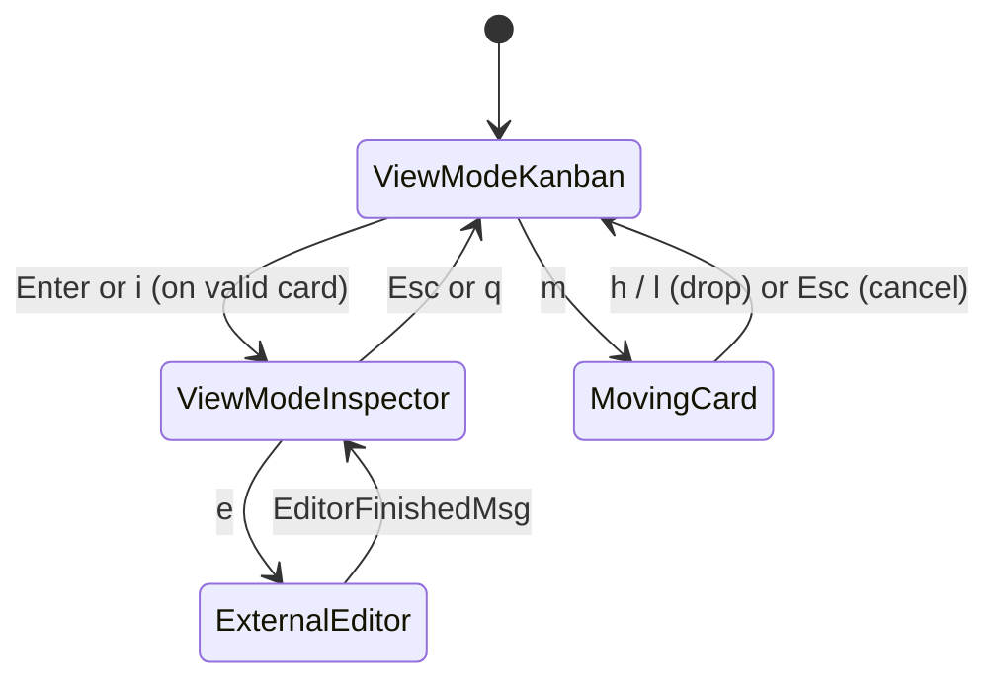

# tui

## Overview
Package `tui` contains the interactive Bubble Tea terminal user interface and Lip Gloss styling for `gh-terrorizer`. It implements a 3-tier terminal workstation architecture inspired by Lazygit: a persistent Top Bar displaying session, ambient Timewarrior status, and on-demand synchronization timestamps; an adaptable Main Area presenting either responsive multi-column Kanban boards or a centered, scrollable Issue Inspector Modal with word-wrapped markdown bodies; and a context-sensitive Bottom Bar rendering dynamic navigation keybinding hints and notification toasts.

## Architecture & 3-Tier Layout Geometry

Total terminal lines $H$ and width $W$ are dynamically budgeted and conserved across all rendered frames:

$$h_{\text{main}} = H - \text{lipgloss.Height}(\text{topBar}) - \text{lipgloss.Height}(\text{bottomBar})$$
$$h_{\text{content}} = h_{\text{main}} - 2 \quad (\text{Kanban column inner content height})$$

```text
┌────────────────────────────────────────────────────────────────────────────────────────┐
│ 󰄶 gh-terrorizer │ ejablonski/gh-terrorizer #1 │ 󱎫 gh-42 [01:23:45] │ 󰄬 Synced (r: sync) │  <- Top Bar
├────────────────────────────────────────────────────────────────────────────────────────┤
│ ╭─ Todo (3) ────╮ ╭─ In Progress (2) ─╮ ╭─ Done (5) ─────────────────────────────────╮ │
│ │  #10 Task 1  │ │ ┏━━━━━━━━━━━━━━━┓ │ │  #05 Setup Repo                            │ │  <- Main Area
│ │  󱎫 1.00h      │ │ ┃  #42 Task 3  ┃ │ │  󱎫 0.50h                                    │ │     (h_main rows)
│ │ ╭───────────╮ │ │ ┃  󱎫 0.50h      ┃ │ ╰────────────────────────────────────────────╯ │     Kanban or Modal
│ │ │  #20 Task│ │ │ ┗━━━━━━━━━━━━━━━┛ │                                                │
│ │ ╰───────────╯ │ ╰───────────────────╯                                                │
│ ╰───────────────╯                                                                      │
├────────────────────────────────────────────────────────────────────────────────────────┤
│ h/l: cols • j/k: cards • m: move • H/L: shift • t: timer • r: sync • Enter/i: inspect • q: quit │  <- Bottom Bar
└────────────────────────────────────────────────────────────────────────────────────────┘
```

Rendering is decoupled from state management via pure, deterministic layout functions located in [`render.go`](file:///home/ejablonski/dev/gh-terrorizer/internal/tui/render.go):
- `(Model) renderTopBar(width int) string`: Renders repository/project details, live in-memory Timewarrior timer badge (`activeTimerTag` + elapsed time), and sync status. Truncates owner prefix on compact displays ($W < 85$).
- `(Model) renderBottomBar(width int) string`: Context-sensitive keybinding strip and error/toast notification badges.
- `(Model) renderInspectorModal(width, height int) string`: Renders the centered modal window framing issue metadata, status badge, milestone, tracked hours, and word-wrapped issue body inside an embedded [`bubbles/viewport`](https://github.com/charmbracelet/bubbles).
- `(Model) renderKanbanBoard(width, height int) string`: Renders multi-column board or single-column tabbed view depending on terminal width.
- `formatRelativeTime(t time.Time) string`: Formats synchronization timestamps into human-readable relative labels (`󰄬 Initialized`, `󰄬 Synced just now`, `󰄬 Synced %dm ago`).

## Modal Geometry & Viewport Lifecycle

When inspecting an issue card, the centered modal geometry is calculated with lower-bound clamps:

$$W_{\text{modal}} = \max(16, \min(W - 2, \lfloor 0.85 \times W \rfloor))$$
$$H_{\text{modal}} = \max(7, \min(h_{\text{main}} - 2, \lfloor 0.85 \times h_{\text{main}} \rfloor))$$
$$W_{\text{viewport}} = \max(10, W_{\text{modal}} - 4)$$
$$H_{\text{viewport}} = \max(2, H_{\text{modal}} - 5)$$

Header titles are truncated to $W_{\text{avail}} = \max(0, W_{\text{modal}} - 6)$ characters via `runewidth.Truncate`, preventing outer border fractures. The issue body is wrapped to $W_{\text{viewport}}$ characters using Lip Gloss, disabling horizontal panning to eliminate ANSI truncation artifacts. If the body is empty, an italicized placeholder (`No description provided.`) is displayed.

## State Machine & Key Routing

Application mode transitions between Kanban board navigation and focused issue inspection via `ViewMode`:



| Key | Mode | Action |
| :---: | :---: | :--- |
| `Ctrl+C` | Global | Exit `gh-terrorizer` immediately (`tea.Quit`) |
| `h` / `l` | Kanban | Select adjacent column (or move/drop card if `movingCard == true`) |
| `j` / `k` | Kanban | Select adjacent card in active column |
| `m` | Kanban | Toggle card movement mode |
| `H` / `L` | Kanban | Shift focused card to previous / next column |
| `t` | Kanban | Toggle Timewarrior tracking session on focused card |
| `r` | Kanban | Trigger ambient on-demand board synchronization (`fetchBoardCmd`) |
| `Enter` / `i` | Kanban | Open Issue Inspector Modal on focused card |
| `q` | Kanban | Exit application (`tea.Quit`) |
| `j` / `k` / `down` / `up` | Inspector | Scroll modal body 1 line down / up |
| `d` / `u` / `pgdown` / `pgup` / `space` | Inspector | Scroll modal body half or full page |
| `g` / `G` / `home` / `end` | Inspector | Jump to top / bottom of modal body |
| `e` | Inspector | Suspend TUI and edit markdown body in `$EDITOR` |
| `Esc` / `q` | Inspector | Close modal and restore Kanban board focus without quitting |

## Interface

- [`ViewMode`](file:///home/ejablonski/dev/gh-terrorizer/internal/tui/model.go): Enum distinguishing active workstation modes (`ViewModeKanban`, `ViewModeInspector`).
- [`GitHubClientInterface`](file:///home/ejablonski/dev/gh-terrorizer/internal/tui/model.go): Abstracts GitHub board queries, status moves, and hour mutations for testability.
- [`TimeTrackerInterface`](file:///home/ejablonski/dev/gh-terrorizer/internal/tui/model.go): Abstracts Timewarrior CLI actions (`Start`, `Stop`, `IsActive`, `GetActiveTag`).
- [`Model`](file:///home/ejablonski/dev/gh-terrorizer/internal/tui/model.go): Root Bubble Tea workstation state model implementing `tea.Model`.
- [`NewModel(client GitHubClientInterface, tracker TimeTrackerInterface, cfg *config.Config) Model`](file:///home/ejablonski/dev/gh-terrorizer/internal/tui/model.go): Initializes the TUI workstation model.
- [`(Model) Init() tea.Cmd`](file:///home/ejablonski/dev/gh-terrorizer/internal/tui/model.go): Dispatches initial board fetch and 1s ticker commands.
- [`(Model) Update(msg tea.Msg) (tea.Model, tea.Cmd)`](file:///home/ejablonski/dev/gh-terrorizer/internal/tui/model.go): Handles input events, modal viewports, external editor launches, and timer updates.
- [`(Model) View() string`](file:///home/ejablonski/dev/gh-terrorizer/internal/tui/model.go): Renders the dynamic 3-tier workstation layout.
- [`(Model) VisibleColumnCount() int`](file:///home/ejablonski/dev/gh-terrorizer/internal/tui/model.go): Computes the number of side-by-side columns that fit within current terminal width.
- [`(Model) ItemsInColumn(optionID string) []github.ProjectItem`](file:///home/ejablonski/dev/gh-terrorizer/internal/tui/model.go): Filters cards belonging to a specific status option ID.
- [`(Model) SelectedItem() *github.ProjectItem`](file:///home/ejablonski/dev/gh-terrorizer/internal/tui/model.go): Returns the currently focused card.
- [`MinColumnWidth`](file:///home/ejablonski/dev/gh-terrorizer/internal/tui/model.go): Constant (`25`) defining minimum column character width.
- [`TokyoNightPalette`](file:///home/ejablonski/dev/gh-terrorizer/internal/tui/styles.go): Struct defining color hex codes for the Tokyo Night color system.
- [`GetPalette(variant string) TokyoNightPalette`](file:///home/ejablonski/dev/gh-terrorizer/internal/tui/styles.go): Returns palette colors for `"storm"` or `"night"`.
- [`Styles`](file:///home/ejablonski/dev/gh-terrorizer/internal/tui/styles.go): Collection of Lip Gloss styles used across all workstation tiers and modal frames.
- [`NewStyles(p TokyoNightPalette) Styles`](file:///home/ejablonski/dev/gh-terrorizer/internal/tui/styles.go): Initializes styling tokens.
- [`(*Styles) Icon(iconName string) string`](file:///home/ejablonski/dev/gh-terrorizer/internal/tui/styles.go): Resolves Nerd Font glyphs with ASCII fallbacks.

## Invariants

- Total rendered view height strictly equals terminal height $H$ by budgeting $h_{\text{main}} = H - \text{lipgloss.Height}(\text{topBar}) - \text{lipgloss.Height}(\text{bottomBar})$, preventing vertical scrolling or bottom border truncation.
- Opening and closing the Issue Inspector Modal preserves exact column and card cursor coordinates (`m.activeColumn`, `m.activeCard`).
- Remote synchronization via `BoardFetchedMsg` preserves active cursor coordinates when issues relocate and closes the modal gracefully if the inspected card was deleted remotely.
- In-memory 1s ticker updates elapsed tracking duration without spawning external subprocesses.
- Optimistic card movement rolls back to `SourceOptionID` if the upstream `CardMovedMsg` returns an error.

## Side Effects

- Creates and unlinks temporary markdown files in `os.TempDir()` (`gh-terrorizer-*.md`).
- Suspends the Bubble Tea event loop to spawn external text editor processes (`$EDITOR`, `$VISUAL`, or `nano`) via `tea.ExecProcess`.
- Dispatches asynchronous network operations to GitHub and subprocess calls to `timew`.

## Verification

- Run all unit tests with race detection: `go test -v -race ./internal/tui/...`
- Check statement and branch test coverage ($\ge 85\%$):
  ```bash
  go test -coverprofile=/tmp/coverage.out ./internal/tui/...
  go tool cover -func=/tmp/coverage.out
  ```
